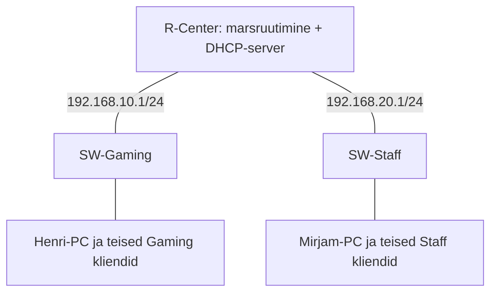
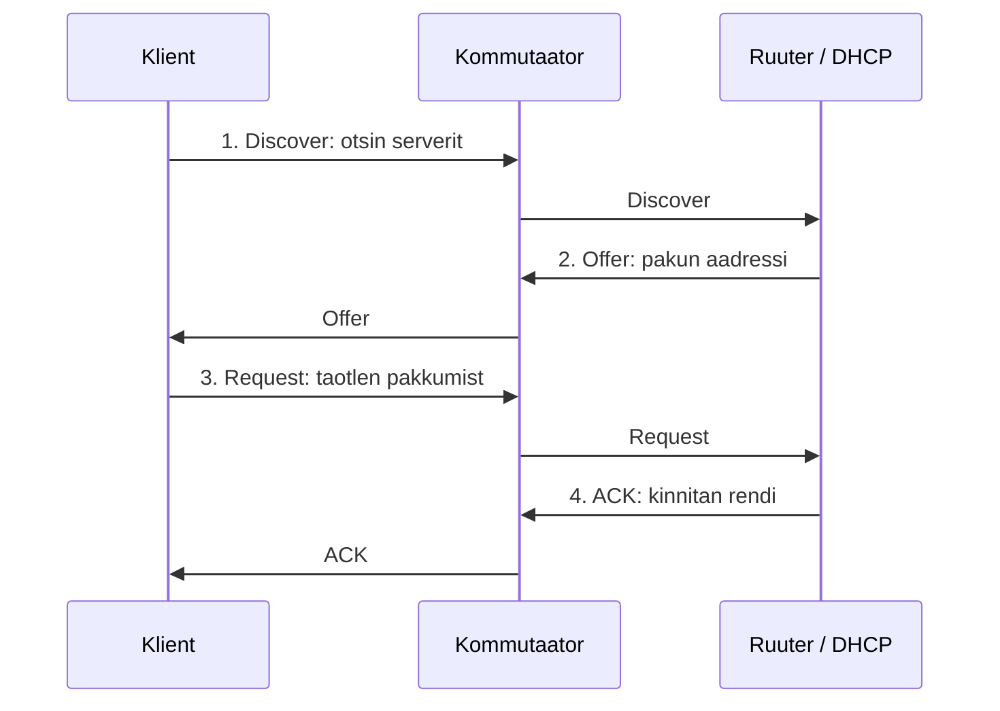

<script setup>
import './dhcp-figures.css'
</script>

# 6. DHCP: käsitsi seadistamisest automaatikani

::: info Õpiväljund
Pärast kohtumist oskad viia kahe toimiva LAN-i arvutid DHCP-le ning tõendada kliendi võrguparameetrite ja ruuteri renditabeli abil, et aadressid pärinevad õigest poolist.
:::

## Miks me seda teeme?

Eelmises tunnis andsid arvutitele IP-aadressi, maski ja vaikelüüsi käsitsi. Nüüd tuleb Karli mängukeskusesse kümme arvutit juurde. Iga arvuti seadistamine võtab aega ja ühe numbri valesti sisestamine võib ühenduse rikkuda.

Täna paneme olemasoleva ruuteri võrguandmeid automaatselt jagama. **DHCP ei asenda IP-aadressi, maski ega vaikelüüsi: see annab need kliendile inimese eest.** Võrkudevaheline liiklus jääb endiselt ruuteri marsruutimise ülesandeks.

## Eeldused ja lähteolukorra kontroll

Vajad Packet Tracerit, eelmise tunni faili `05-lan-routing.pkt` ning kahe LAN-iga ruuterit `R-Center`. Kasuta sama ruuterimudelit ja liideseid nagu eelmises tunnis. Selle töö jaoks pole eraldi serveriseadet vaja.

1. Ava fail ja salvesta koopia nimega `06-dhcp.pkt`.
2. Ruuteril käivita haldaja režiimis (`R-Center#`) `show ip interface brief`. Gaming liides peab olema `192.168.10.1`, Staff liides `192.168.20.1`; mõlemad **up / up**.
3. Kontrolli arvutite olemasolevaid aadresse ja maski. Mask on mõlemas LAN-is `255.255.255.0`.
4. Pingi Gaming arvutist Staff arvuti **praegust** IP-aadressi. Kui ühendus ei tööta, paranda esmalt [eelmise tunni võrk](./kohtumine-05-esimesed-lanid).

::: warning Kontrolli oma faili, mitte ainult näidet
Eelmise kohtumise juhendis on Henri `.21`, Kadri `.22` ja Mirjam `.21` oma LAN-is. Kui tegite tunnis kummassegi LAN-i ühe arvuti aadressiga `.10`, on ka see sobiv lähteolukord. Kirjuta tegelikud aadressid üles. Staff-arvuti `192.168.20.10` tuleb selle tunni jooksul DHCP-le viia, sest järgmisel korral kasutab seda aadressi server.
:::

## Enne DHCP-d: millisesse võrku arvuti kuulub?

**Sama mask ei tähenda sama alamvõrku.** Mask ütleb, milline osa IP-aadressist on võrguosa. Maski `255.255.255.0` ehk `/24` korral moodustavad võrguosa esimesed kolm arvu ja hostiosa viimane arv. See jaotus kehtib just `/24` maskiga.

<figure class="dhcp-figure" aria-labelledby="dhcp-ip-caption">
  <div class="dhcp-figure-title">Üks aadress, kaks osa · /24</div>
  <div class="dhcp-ip-parts">
    <div class="dhcp-network"><span class="dhcp-number">192.168.10</span><span>Võrguosa · 24 bitti</span></div>
    <div class="dhcp-host"><span class="dhcp-number">.21</span><span>Hostiosa · 8 bitti</span></div>
  </div>
  <div class="dhcp-comparison"><span><strong>192.168.10.21</strong> ja <strong>192.168.10.50</strong><br />Sama /24 alamvõrk</span><span><strong>192.168.10.21</strong> ja <strong>192.168.20.21</strong><br />Eri /24 alamvõrgud → vaja ruuterit</span></div>
  <figcaption id="dhcp-ip-caption">IP-aadressi neli arvu on oktetid: igaüks sisaldab 8 bitti. Siin eristavad Gaming ja Staff võrku kolmandad oktetid 10 ja 20.</figcaption>
</figure>

Host on võrgus olev seade, näiteks arvuti. `192.168.10.0/24` ja `192.168.20.0/24` on meie **alamvõrgud**, mitte „kaks hosti”. Mõlemas võrgus võib arvuti viimane aadressiosa olla sama: täielikud IP-aadressid on siiski erinevad.

**Ennusta:** kas `192.168.10.35/24` vajab `192.168.20.35` juurde jõudmiseks vaikelüüsi? Põhjenda võrguosa abil.

## Mida DHCP kliendile annab?

**DHCP** (*Dynamic Host Configuration Protocol*) on võrguseadistuse edastamise protokoll. **DHCP-server** jagab seadistust, **DHCP-klient** küsib seda. Meie ruuter täidab täna ka serveri rolli.

Selles laboris kontrollime nelja võrguparameetrit. DHCP võib edastada ka muid parameetreid.

| Parameeter | Gaming kliendi näide | Mida see kliendile ütleb? |
| --- | --- | --- |
| IP-aadress | `192.168.10.21` | Minu enda aadress |
| Alamvõrgumask | `255.255.255.0` | Kuidas eristada võrguosa ja hostiosa |
| Vaikelüüs (*default gateway*) | `192.168.10.1` | Kellele saata liiklus teistesse võrkudesse |
| DNS-server | `192.168.20.10` | Kellelt küsida nimele vastavat IP-aadressi |

DNS-serveri lisame **järgmises tunnis**. Täna saab klient juba selle aadressi teada, kuid nimelahendus ei tööta enne DNS-teenuse seadistamist. DNS-aadressi saamine ei tõenda DNS-teenuse toimimist.

### Rent: aadress ajutiseks kasutamiseks

Dünaamiline aadress antakse **rendile** (*lease*). Klient saab renti enne aegumist uuendada ja võib jätkata sama aadressiga. Kui klient lahkub ilma aadressi vabastamata, jääb rent serveris kuni aegumiseni kehtima. Sülearvuti sulgemine ei teata serverile tingimata, et aadressi võib kohe uuesti jagada.

Server peab arvestust aadresside ja klientide seoste üle. Klient võib küsida varem kasutatud aadressi; server otsustab oma seadistuse ja aadressi saadavuse põhjal, kas selle kasutamine on lubatud.

## Aadressipool, vahemik ja välistused

**Aadressipool** (*pool*) on serveri seadistus ühe alamvõrgu aadresside ja kliendile antavate parameetrite jaoks. Pooli nimi, näiteks `GAMING`, on meie valitud silt. **Välistus** (*exclusion*) keelab serveril kindlaid aadresse dünaamiliselt välja anda.

Meie [aadressiplaan](./kohtumine-04-ipv4-ja-aadressiplaan) jagab mõlema `/24` alamvõrgu nii:

<figure class="dhcp-figure" aria-labelledby="dhcp-range-caption">
  <div class="dhcp-figure-title">Kellele aadressid jäävad?</div>
  <div class="dhcp-range-prefix">Gaming: 192.168.10.<strong>x</strong> · Staff: 192.168.20.<strong>x</strong></div>
  <div class="dhcp-ranges">
    <div class="dhcp-range dhcp-infra"><strong>.1–.20</strong><span>Taristu</span><small>DHCP-st välistatud</small></div>
    <div class="dhcp-range dhcp-dynamic"><strong>.21–.200</strong><span>DHCP kliendid</span><small>180 jagatavat aadressi</small></div>
    <div class="dhcp-range dhcp-spare"><strong>.201–.254</strong><span>Varu</span><small>DHCP-st välistatud</small></div>
  </div>
  <div class="dhcp-range-notes"><span><strong>.0</strong> · võrguaadress</span><span><strong>.255</strong> · leviedastusaadress</span></div>
  <figcaption id="dhcp-range-caption">Skeem ei ole mõõtkavas. .0 ja .255 ei ole selles /24 võrgus kliendiaadressid. Vahemikud näitavad kummagi alamvõrgu IP-aadresside viimase okteti jaotust.</figcaption>
</figure>

| Pooli nimi | Alamvõrk | Dünaamiline vahemik | Välistused |
| --- | --- | --- | --- |
| `GAMING` | `192.168.10.0/24` | `192.168.10.21–192.168.10.200` | `.1–.20` ja `.201–.254` |
| `STAFF` | `192.168.20.0/24` | `192.168.20.21–192.168.20.200` | `.1–.20` ja `.201–.254` |

- `.1` on kummaski võrgus ruuteri liidese aadress.
- Staff võrgu `.10` jätame tulevasele serverile.
- `.201–.254` on tavalised kasutatavad hostiaadressid, kuid **meie plaan** jätab need varuks. Nende väljastamine ei tekita iseenesest konflikti.
- Välistus ei seadista ühelegi seadmele aadressi. Näiteks serveri `.10` tuleb hiljem serveril eraldi määrata.

**Ennusta:** kas DHCP tohib meie plaani järgi väljastada aadresse `.20`, `.21`, `.200` ja `.201`? Võrdle vastust joonisega.

## Kuidas päring jõuab õigesse pooli?



Uus klient saadab **DHCP Discover** päringu leviedastusena (*broadcast*) oma kohalikku LAN-i. Kommutaator levitab seda selles LAN-is; ruuter ei edasta seda vaikimisi teise alamvõrku.

Meie ruuter saab päringu ise kätte, sest tal on kummaski LAN-is liides ja ta töötab ka DHCP-serverina. Otse ühendatud kliendi puhul valib ta pooli päringu vastuvõtnud liidese alamvõrgu järgi. Pooli nimi `GAMING` ei seo pooli kommutaatori nimega.

::: tip Kolm erinevat seadistust
`ip address` ruuteri liidesel annab aadressi **ruuterile endale**. Pooli `default-router` teatab lüüsi aadressi **kliendile**. Marsruutimine edastab hiljem liiklust võrkude vahel. DHCP seadistamine ei asenda toimivaid ruuteri liideseid.
:::

Eraldi alamvõrgus asuva DHCP-serveri korral võib vaja minna DHCP vahendajat (*relay*). Selles laboris seda ei seadistata.

## Praktiline töö: paneme DHCP tööle

### 1. Valmista kõik olemasolevad kliendid ette

Enne poolide loomist vii **kõik olemasolevad tavalised arvutid**, sealhulgas Kadri-PC, DHCP režiimi: **Desktop → IP Configuration → DHCP**. Server pole veel seadistatud, seega päring võib praegu ebaõnnestuda. See on selles sammus oodatav. Ruuteri liideseid ära muuda.

Nii ei jää varasemaid staatilisi `.21` või `.22` aadresse serveri jagatavasse vahemikku. Ka Staff-arvuti senine `.10` vabaneb tulevase serveri jaoks. Kui sinu failis on rohkem staatilisi seadmeid, kontrolli need samuti üle: jagatavasse vahemikku ei tohi jääda käsitsi seadistatud aadresse.

### 2. Määra välistused ruuteril

Ava ruuteri **CLI**. Alusta `R-Center>` režiimist:

```text
enable
configure terminal
ip dhcp excluded-address 192.168.10.1 192.168.10.20
ip dhcp excluded-address 192.168.10.201 192.168.10.254
```

`excluded-address` välistab mõlemad piirid kaasa arvatud. Gaming võrgu jagatavaks vahemikuks jääb `.21–.200`.

**Proovi ise:** lisa Staff võrgu kaks välistust. Oled endiselt üldseadistuses (`R-Center(config)#`).

::: details Vihje: millised arvud muutuvad?
Kasuta samu viimaste oktettide piire. Staff võrgu kolmas oktett on `20`.
:::

### 3. Seadista Gaming pool koos põhjendustega

```text
ip dhcp pool GAMING
```

Loob või avab nimega `GAMING` pooli. Käsurea tähis muutub: `R-Center(dhcp-config)#`.

```text
network 192.168.10.0 255.255.255.0
```

Määrab pooli **alamvõrgu**, mitte esimese väljastatava aadressi. Jagatavat hulka piiravad välistused. Seepärast ei kirjuta me siia `192.168.10.21`.

```text
default-router 192.168.10.1
dns-server 192.168.20.10
exit
end
```

`default-router` annab Gaming kliendile vaikelüüsi; `dns-server` annab tulevase DNS-serveri aadressi. Need käsud ei muuda ruuteri liidese IP-d ega käivita DNS-teenust. `exit` väljub poolist ja `end` viib haldaja režiimi.

**Kiire kontroll:** Henri ja Kadri arvutil vali **Static → DHCP**, et nad küsiksid nüüd seadistust uuesti. Vaata saadud IP-d, maski ja vaikelüüsi. Mõlemad peavad saama erineva Gaming aadressi vahemikust `.21–.200`. Täpset viimast arvu ette ei eeldata.

### 4. Seadista Staff pool iseseisvalt

Mine ruuteril käsuga `configure terminal` üldseadistusse. Loo pool nimega `STAFF` järgmiste andmetega:

| Parameeter | Väärtus |
| --- | --- |
| Alamvõrk | `192.168.20.0` |
| Mask | `255.255.255.0` |
| Vaikelüüs | `192.168.20.1` |
| DNS-server | `192.168.20.10` |

Lõpeta käskudega `exit` ja `end`. Mirjami arvutil vali **Static → DHCP**. Kontrolli, et ta sai Staff võrgu `.21–.200` aadressi, mitte senise staatilise `.10`.

::: details Vihje: kust alustada?
Gaming näites alustas pooli seadistamist `ip dhcp pool GAMING`. Milline peaks olema Staff pooli nimi? Millised read muutuvad ja milline DNS-aadress jääb samaks?
:::

### 5. Lisa kummassegi LAN-i üks uus arvuti

1. Vali **End Devices → PC**. Lisa üks Gaming ja teine Staff võrku.
2. Nimeta need `Uus-Gaming-PC` ja `Uus-Staff-PC`.
3. Ühenda kumbki oma kommutaatori vaba pordiga sirge kaabliga (*Copper Straight-Through*). Oota, kuni ühendus on roheline.
4. Ava **Desktop → IP Configuration → DHCP**.
5. Kontrolli, kas uus klient sai oma võrgu aadressi, õige maski, vaikelüüsi ja DNS-serveri aadressi.

**Mõtesta:** miks ei pidanud sa uue arvuti lisamiseks ruuteris uut pooli looma?

## Kontrolli ja tõenda tulemust

### Kliendi seadistus

Ava igal arvutil **Desktop → Command Prompt**:

```text
ipconfig
```

DNS-serveri aadressi kontrolli ka **Desktop → IP Configuration** vaates. Kõik Packet Traceri versioonid ei näita lihtsa `ipconfig` käsuga samu välju.

Täida iga olemasoleva ja uue kliendi kohta rida. Näidisridades on oodatav vahemik, mitte mõõdetud tulemus. Kui Kadri-PC-d sinu lähtefailis pole, jäta tema rida välja.

| Seade | Saadud IP | Mask | Vaikelüüs | DNS |
| --- | --- | --- | --- | --- |
| Henri-PC | `192.168.10.21–.200` | `255.255.255.0` | `192.168.10.1` | `192.168.20.10` |
| Kadri-PC (kui olemas) | Gaming vahemik | sama mask | Gaming lüüs | sama DNS |
| Mirjam-PC | `192.168.20.21–.200` | sama mask | `192.168.20.1` | sama DNS |
| Uus-Gaming-PC | Gaming vahemik | sama mask | Gaming lüüs | sama DNS |
| Uus-Staff-PC | Staff vahemik | sama mask | Staff lüüs | sama DNS |

### Serveri arvestus

Käivita ruuteril haldaja režiimis (`R-Center#`):

```text
show ip dhcp binding
show ip dhcp pool
show running-config
```

- `binding` näitab renditud aadresse ja klientide tunnuseid. Tunnus võib sisaldada MAC-aadressi; väljundi kuju sõltub seadmest.
- `pool` annab ülevaate poolidest ja nende kasutusest.
- `running-config` võimaldab kontrollida poolide võrke, lüüse, DNS-aadressi ja kõiki nelja välistust.

Leia renditabelist oma klientide **tegelikud IP-aadressid** ja seo need klientidega. Ära eelda, et esimesena lisatud klient saab alati `.21`. Veateateta käsu sisestamine üksi ei tõenda DHCP toimimist.

### Ühenduvus

Gaming kliendilt kontrolli järjekorras:

1. `ping 192.168.10.1` — oma ruuteri liides.
2. `ping` teise Gaming kliendi **tegelikule aadressile** — sama LAN.
3. `ping` Staff kliendi **tegelikule aadressile** — teine LAN.

Staff kliendilt kontrolli oma lüüsi `192.168.20.1` ja ühe Gaming kliendi aadressi. Kirjuta üles lähte- ja sihtseade, sihtaadress ning tegelik tulemus. Esimene ping võib ARP aadressilahenduse tõttu ebaõnnestuda; korda katset.

Ära testi veel `gaming.test` nime: DNS-teenust pole ehitatud.

### Kui aadressi ei tule

| Mida kontrollida? | Milline tulemus on oodatud? |
| --- | --- |
| Kaabel, kommutaator ja ruuteri liides | Õige LAN, ühendus roheline, ruuteri liides up/up |
| Kliendi IP Configuration | DHCP valitud, pärast serveri seadistamist uuesti küsitud |
| Pooli `network` ja mask | Vastavad selle LAN-i ruuteriliidese alamvõrgule |
| Välistused ja vabad aadressid | `.21–.200` pole kogemata tervenisti välistatud ega kasutusel |
| Kliendi aadress ja renditabel | Klient sai oma LAN-i aadressi ja serveris on vastav rent |

Kui klient sai õige aadressi, kuid teine LAN ei vasta, kontrolli eraldi lüüsi ja marsruutimist. Need pole sama probleem kui aadressi mittesaamine.

## Vaata DORA sõnumeid liikumas

Esialgne aadressihange on sageli neli sõnumit: **Discover, Offer, Request, Acknowledge** ehk DORA.



Joonise nooled näitavad sõnumite teekonda. Need ei tähenda, et kõik sõnumid on üksikedastused: esialgne Discover ja valitud pakkumise Request on leviedastused; vastuste edastusviis võib sõltuda olukorrast.

1. Vali **Simulation** ning jäta sündmuste filtrites nähtavaks DHCP.
2. Kasuta uut klienti, kellel pole veel renti. Vajadusel lisa vaatlemiseks ajutine PC Gaming kommutaatori külge ja oota ühenduse valmimist.
3. Vali sellel kliendil **Desktop → IP Configuration → DHCP**.
4. Liigu sündmustes **Capture / Forward** abil ja ava sündmuste üksikasjad. Otsi nelja sõnumit ning jälgi, millise ruuteriliideseni päring jõuab.
5. Võrdle kliendi saadud IP-d ja serveri renditabelit. Naase **Realtime** režiimi. Ajutise vaatluskliendi võib eemaldada.

Juba rendiga kliendi uuendus ei pea kordama kogu nelja sammu; ära käsitle lühemat vahetust automaatselt veana.

**Mõtesta:** miks Gaming kliendi esialgne Discover ei ilmu Staff kommutaatori juures? Kuidas saab ruuter siiski mõlema LAN-i klientidele vastata?

## Veakatse: aadress on olemas, aga teise võrku ei pääse

Tee üks muudatus korraga. Enne kontrolli, et tavaline ühenduvus töötab. Kasutame vale lüüsina `192.168.10.254`; veendu, et sinu failis pole sellel aadressil seadet.

**Ennusta:** kui klient saab õige IP ja maski, aga vale lüüsi, kas sama LAN-i ping töötab? Kas teise LAN-i ping töötab?

Muuda ruuteril ainult Gaming pooli lüüsi:

```text
configure terminal
ip dhcp pool GAMING
no default-router
default-router 192.168.10.254
end
```

1. Gaming katsekliendil vali **Static → DHCP**. Ruuteri seadistuse muutmine ei kirjuta olemasoleva rendiga kliendi väärtusi kohe ümber.
2. Kontrolli kliendi seadistusest, et lüüs on nüüd **`.254`**. Kui see pole muutunud, pole katse veel valmis: küsi seadistus uuesti. Vajadusel kasuta uut katseklienti.
3. Pingi teist Gaming klienti ja seejärel Staff klienti nende **praegustel aadressidel**. Kirjuta tegelikud tulemused üles.
4. Võrdle vaatlust ennustusega: sama LAN-i jaoks pole lüüsi vaja, teise LAN-i liiklus saadetakse valele lüüsile.

**Taasta ruuteril õige lüüs:**

```text
configure terminal
ip dhcp pool GAMING
no default-router
default-router 192.168.10.1
end
```

Uuenda seadistus **kõigil Gaming klientidel, kes said vale lüüsi**. Kontrolli, et lüüs on jälle `.1`, ning korda sama ja teise LAN-i pinge. Töö peab lõppema taastatud võrguga. Ära esita tahtlikult vigast faili.

## Esitatav töö ja valmisoleku kontroll

- Fail `06-dhcp.pkt`, kus kõik olemasolevad ja uued tavalised arvutid kasutavad DHCP-d. Ruuteri liideste aadressid jäävad käsitsi seadistatuks ning serveri `.10` on vaba.
- Täidetud klienditabel tegelike IP-de, maskide, lüüside ja DNS-aadressidega. Kõigi klientide IP-d peavad jääma oma LAN-i `.21–.200` vahemikku ja olema selle LAN-i piires kordumatud.
- Ruuteri renditabeli tõend, kus leiad oma klientide aadressid, ning poolide ja välistuste kontroll.
- Ühenduvuse kontroll mõlemast LAN-ist koos lähte- ja sihtseadmete ning tulemustega.
- Ühe veakatse ennustus, vaatlus, põhjendus ja pärast taastamist tehtud kontroll.

Salvesta ruuteri seadistus haldaja režiimis käsuga `copy running-config startup-config`; kinnita pakutud sihtnimi Enteriga. Salvesta ka Packet Traceri fail. Ava fail uuesti ning veendu, et poolid on alles ja kliendid saavad õige seadistuse.

**Selgita oma sõnadega:** miks jäi serveri `.10` DHCP-st välja? Miks `default-router` ei muuda ruuteri liidese IP-d? Miks DNS-aadressi olemasolu ei tõenda DNS-i töötamist?

## Laiendus kiiremale õppijale

Ennusta, millal saab lahkunud kliendi aadressi uuesti kasutada. Uuri renditabeli infot ja võrdle uue kliendi aadressihanget juba rendiga kliendi uuendusega. Ära eelda, et mõlemal juhul näed sama sõnumijada.

Aadressikonflikti võib uurida eraldi failikoopias õpetaja juhendamisel. Simulaatori sümptomit ei saa ette garanteerida; konflikti puudumise tõendiks ei piisa sellest, et üks ping õnnestus.

## Kokkuvõte

- DHCP väljastab kliendile võrguseadistuse; ruuter marsruudib endiselt liiklust eri võrkude vahel.
- Pooli alamvõrk ja välistused määravad jagatava aadressihulga. Välistus ei anna seadmele aadressi.
- Sama `/24` maskiga võivad seadmed kuuluda eri alamvõrkudesse.
- Teenuse toimimist tõendavad kliendi parameetrid, serveri renditabel ja tegelikud ühenduvuskatsed.

## Allikad

- [RFC 2131](https://www.rfc-editor.org/rfc/rfc2131) — DHCP esialgne aadressihange, kliendi aadressisoov ja rendi uuendamine; eriti jaotised 3.1 ja 4.4.
- [Cisco IOS DHCP serveri juhend](https://www.cisco.com/c/en/us/td/docs/ios-xml/ios/ipaddr_dhcp/configuration/12-4/dhcp-12-4-book/config-dhcp-server.html) — poolid, välistused ja pooli valik. Packet Tracer toetab IOS-i võimalusi piiratud ulatuses.
