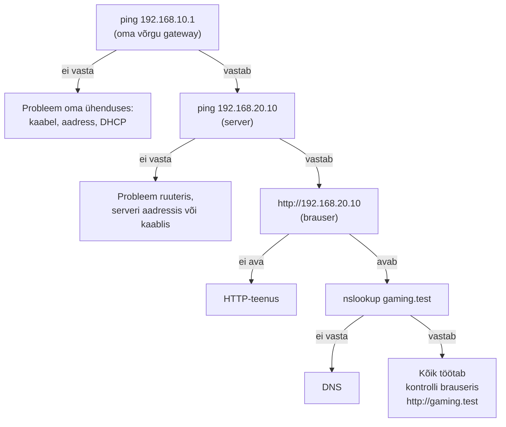

# 7. Sisemine server: HTTP kõigepealt, DNS seejärel

::: info Õpiväljund
Pärast kohtumist oskad seadistada serveri staatilise aadressiga, teha veebilehe kättesaadavaks IP kaudu, seejärel nime kaudu, ning eristada IP-ühenduse, HTTP-teenuse ja DNS-i viga.
:::

## Mis Karli keskuses nüüd juhtub?

Mirjam tahab, et mängijad näeksid broneeringute lehte. Karl lisab serveri Staff võrku ja paneb sinna lihtsa lehe. Kõigepealt proovitakse seda **numbriga** (IP kaudu). Mängijad aga ei taha numbreid meelde jätta. Nad tahavad kirjutada `gaming.test`. Selleks on vaja kolmandat asja, nimeteenust.

Sellel kohtumisel ehitame mõlemad ja õpime kontrollima, **kumb osa** on katki, kui midagi ei tööta.

## Kolm eri asja

| Asi | Mida see teeb | Kuidas kontrollida |
| --- | --- | --- |
| **IP-ühendus** | Paketid jõuavad seadmeni | `ping 192.168.20.10` |
| **HTTP-teenus** | Server vastab veebilehega | Ava brauseris `http://192.168.20.10` |
| **DNS** | Nimi muudetakse aadressiks | Ava brauseris `http://gaming.test` |

**HTTP** (*HyperText Transfer Protocol*) on veebilehtede keel: brauser küsib ja server vastab lehega. **DNS** (*Domain Name System*) on nimeraamat: mängija kirjutab nime, arvuti küsib DNS-ilt "mis on `gaming.test` aadress?" ja saab vastuseks numbri.

Analoogia: telefoniraamat. Sa tead nime, aga helistamiseks on vaja numbrit. Raamat annab numbri. DNS on see raamat.

Analoogia piir: DNS ei "leia inimest". Ta ütleb ainult aadressi. Kui veebiteenus on välja lülitatud, võib töötav DNS endiselt õige aadressi anda, kuid veebileht ei avane. Meie laboris on mõlemad teenused samas seadmes: kogu seadme väljalülitamisel kaob ka selle DNS-teenus.

## 1. samm: serveri lisamine

Ava `06-dhcp.pkt` ja salvesta `07-services.pkt`.

**Enne jätkamist kontrolli:** kõik eelmise tunni olemasolevad ja uued tavalised arvutid kasutavad DHCP-d, mõlema LAN-i kliendid saavad oma võrgu `.21–.200` aadressi ning Gaming klientide lüüs on pärast veakatset taas `192.168.10.1`. Staff võrgu `192.168.20.10` peab olema vaba: kui see oli varem Mirjami arvutil, on Mirjam nüüd DHCP-l. Ära muuda teiste klientide aadresse näidisnumbrite järgi.

1. Lisa **End Devices → Server**. Nimeta `SRV-Staff`.
2. Ühenda `SW-Staff` kommutaatoriga sirge kaabliga.
3. Serveri aadress **peab olema kindel**, sest kõik teised arvutid peavad seda leidma. Ava **Desktop → IP Configuration**, vali **Static**:
   - IP: `192.168.20.10`
   - Mask: `255.255.255.0`
   - Gateway: `192.168.20.1`
   - DNS: `192.168.20.10` (server on ka ise DNS-server)

Selles laboris kasutame serveril **staatilist aadressi**, et DHCP-poolides antud DNS-aadress ja DNS-kirjed jääksid õigeks. Tavalise dünaamilise rendi korral võib server saada hiljem teise aadressi. Päris võrgus võib püsiva aadressi tagada ka DHCP-reservatsiooniga, kuid seda me siin ei seadista. `.10` välistus takistab selle jagamist teistele klientidele; aadressi määrame serveril eraldi.

**Kontroll:** Henri arvutist `ping 192.168.20.10`.

## 2. samm: HTTP veebilehe lisamine

1. Ava server → **Services** → **HTTP**.
2. Veendu, et HTTP on **On**.
3. Muuda `index.html` sisu lihtsaks leheks:

```html
<html>
  <body>
    <h1>Karli mängukeskus</h1>
    <p>Broneeringud täna: arvuti 1 (Henri), arvuti 2 (Kadri)</p>
  </body>
</html>
```

Lehe ilu ei ole võrgunduse oluline osa, piisab lihtsast tekstist.

**Kontroll:** Henri arvutil ava **Desktop → Web Browser** ja kirjuta `http://192.168.20.10`. Peab avanema leht.

## 3. samm: DNS-kirje

1. Ava server → **Services** → **DNS**. Veendu, et DNS on **On**.
2. Lisa kirje: **Name** `gaming.test`, **Address** `192.168.20.10`. Vajuta **Add**.

**Kontroll:** vaata Henri arvuti **IP Configuration** vaates, et DNS-server on `192.168.20.10`. Seejärel ava brauseris `http://gaming.test`. Peab avanema sama leht. Korda IP ja nime kaudu avamist ka Staff kliendil ning ühel eelmisel tunnil lisatud uuel kliendil.

Kui IP kaudu leht avaneb, kuid sama leht nime kaudu mitte, kontrolli esmalt kliendi DNS-aadressi, DNS-teenust ja kirjet.

## 4. samm: kontrollime kliendi DNS-aadressi

Eelmises tunnis määrasime DHCP-poolides DNS-serveriks `192.168.20.10`. Klient sai selle aadressi kätte ka siis, kui DNS-serverit veel polnud. DNS-teenuse käivitamine ei muuda DHCP seadistust ega nõua iseenesest rendi uuendamist.

Kontrolli arvuti **Desktop → IP Configuration** vaates, et DNS-server on `192.168.20.10`. Kui muutsid DHCP-poolis DNS-aadressi või kliendil on vana seadistus, vali **Static → DHCP**, et küsida võrguandmed uuesti. Kontrolli seejärel saadud DNS-aadressi ning proovi `nslookup gaming.test` ja veebilehe avamist nime kaudu. Õige DNS-aadress üksi ei tõenda, et DNS-teenus töötab.

## ICMP ja diagnostikakäsud

Kui midagi ei tööta, pead leidma, **kus** ahel katki on. `ping` ja siin kasutatav `tracert` aitavad ühendust uurida **ICMP** (*Internet Control Message Protocol*) abil. ICMP kannab võrgu juht- ja veateateid, näiteks „kas oled seal?” või „sihtkoht pole kättesaadav”. `nslookup` kasutab aga **DNS-i**, mitte ICMP-d.

| Küsimus | Käsk (arvuti Command Prompt) | Mida näitab |
| --- | --- | --- |
| Kas sihtkoht vastab? | `ping 192.168.20.10` | Vastus ja aeg (ms), kadunud paketid |
| Mis aadress on sellel nimel? | `nslookup gaming.test` | DNS-i vastus ja server, kellelt see tuli |
| Mis teed pakett läheb? | `tracert 192.168.20.10` | Kõik hüpped sihtkohani |

Kasuta neid **alt üles**, nagu ehitasid võrku:



Edukas `ping` näitab IP-ühendust, kuid ei tõenda HTTP ega DNS-i toimimist. Kui **HTTP IP kaudu töötab**, aga sama leht nime kaudu ei avane, uuri nimelahendust. DNS-päringu ebaõnnestumine võib tähendada ka seda, et liiklus DNS-serverini ei jõua.

::: warning Vastuseta ping ei tähenda, et server ei tööta
Mõned seadmed ja tulemüürid on seadistatud ICMP-le **mitte vastama**. `tracert` väljundis näed siis ridu `* * *`. Ainult vastuseta ping ei ole tõend, et seade või veebiteenus ei tööta. Kontrolli ka teisel viisil, näiteks brauseris. Seda mõtet kasutame ka kohtumisel 10, kui tõendame, et Guest ei pääse serverisse: ainult "ping ei vasta" ei tõenda midagi.
:::

## Veaotsing: kus on viga?

Allolev tabel on selle kohtumise kõige tähtsam tööriist.

| Sümptom | Tõenäoline põhjus | Mida teha |
| --- | --- | --- |
| `ping` serverisse ei tööta | IP-ühendus (kaabel, aadress, gateway, ruuter) | Vaata `ipconfig`, kaablite tulesid, ruuteri liideseid |
| `ping` töötab, `http://192.168.20.10` ei avane | HTTP-teenus on välja lülitatud või puudub | Ava serveri **Services → HTTP** |
| `http://192.168.20.10` avaneb, `http://gaming.test` ei avane | DNS | Kontrolli DNS-kirjet ja arvuti DNS-aadressi |
| Töötab Staff arvutil, ei tööta Gaming arvutil | Gateway või ruuter | Kontrolli Gaming arvuti gateway'd |

## Mis juhtuks, kui…

Salvesta esmalt toimiv töö. Tee veakatsed **eraldi failikoopias**, üks viga korraga. Iga katse järel taasta seaded ja kontrolli lehe avanemist mõlema LAN-i kliendist.

1. **DNS-teenus välja lülitatud.** Enne katset lisa serveri DNS-i uus kirje `katse.gaming.test` → `192.168.20.10`, kuid ära seda nime veel kliendilt ava. Lülita DNS välja ja proovi seda uut nime: nimelahendus peaks ebaõnnestuma, kuid `http://192.168.20.10` peab endiselt avanema. Taasta DNS ja kontrolli sama nime uuesti. Varem kasutatud `gaming.test` võib kliendi vahemälust veel töötada.
2. **HTTP välja lülitatud.** `ping` ja `nslookup gaming.test` võivad töötada, kuid värske veebipäring ei õnnestu. Lülita HTTP tagasi sisse ja korda brauserikontrolli.

**Valikuline laiendus:** serveri DHCP-le lülitamine võib rikkuda korraga nii veebiteenuse leidmise kui DNS-serverini jõudmise, sest see seade pakub mõlemat teenust. See pole ühe DNS-kirje vea katse. Uuri seda ainult failikoopias ja taasta serveri staatiline `.10` aadress, mask, lüüs ning DNS enne jätkamist.

## Esitatav töö

- Fail `07-services.pkt`.
- Brauserikontroll **mõlemast võrgust** (Gaming ja Staff): ekraanipilt või kirjeldus, et leht avaneb nii IP kui nime kaudu.
- Lühike selgitus oma sõnadega: kuidas eristada IP-ühenduse, HTTP-teenuse ja DNS-i viga.
- Tõend ühe veakatse ja taastamise kohta. Esitatavas failis on server staatilise `.10` aadressiga, DNS ja HTTP sisse lülitatud ning kliendid endiselt DHCP-l.

## Kokkuvõte

| Mõiste | Tähendus |
| --- | --- |
| Server | Seade, mis pakub teenust |
| HTTP | Veebilehtede protokoll |
| DNS | Nimeraamat: nimi → aadress |
| Staatiline aadress | Käsitsi määratud, ei muutu |
| DNS-kirje | Üks rida nimeraamatus: nimi ja aadress |
