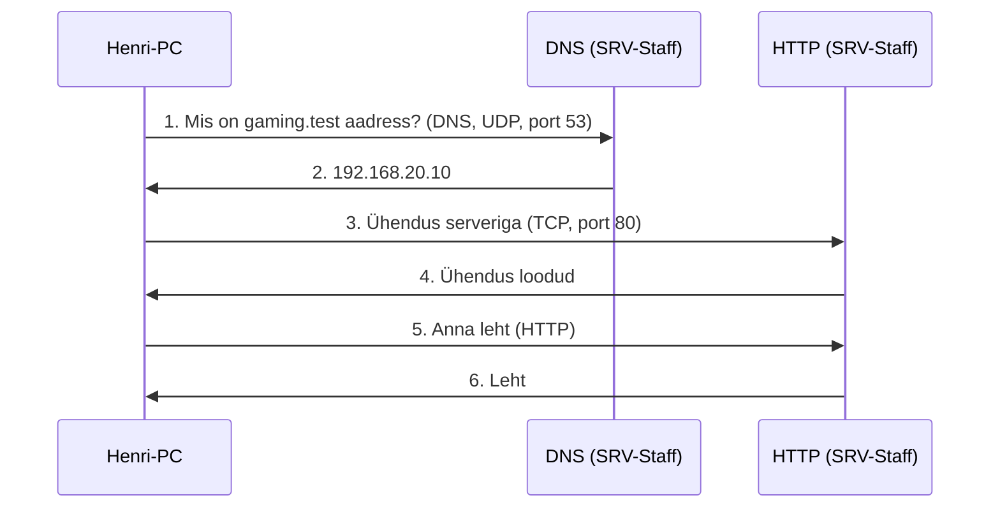
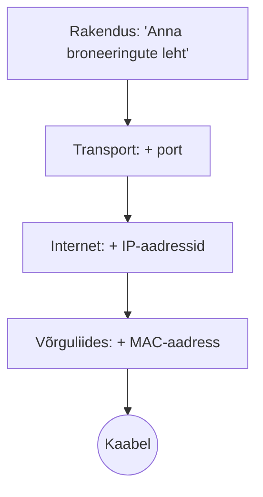
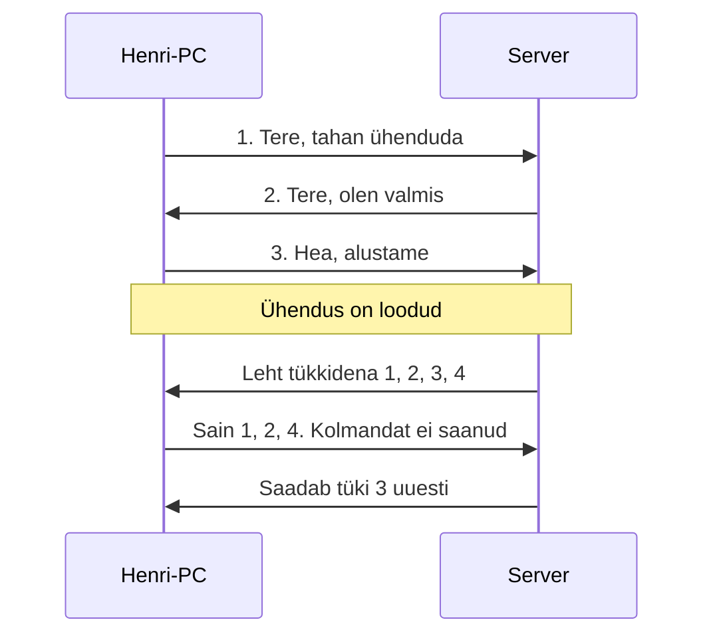

# 8. Vaatame, kuidas DNS ja HTTP töötavad

::: info Õpiväljund
Pärast kohtumist oskad Simulation Mode'is jälgida DNS-i ja HTTP päringut, eristada nime lahendamist ja veebipäringut, seostada teenuse, transpordiprotokolli, pordi, IP ja MAC-aadressi ning kirjeldada päringu teekonda olemasolevas võrgus.
:::

## Mis Karli keskuses nüüd juhtub?

Karli keskuses töötab nüüd leht `gaming.test`. Henri küsib: "Aga mis juhtub, kui ma kirjutan `gaming.test` ja vajutan Enter? Kuidas mu arvuti teab, kuhu minna?"

Täna **vaatame ja katsetame** oma olemasolevas võrgus. Välisvõrgu ehitame pärast WiFi lisamist [eraldi praktilises töös 9A](./valise-testvorgu-ehitamine).

Ava oma `07-services.pkt` ja salvesta koopia nimega `08-observation.pkt`. Enne vaatlust kontrolli, et server on `192.168.20.10`, HTTP ja DNS töötavad ning leht avaneb nii Gaming kui Staff kliendist. Kliendid jäävad DHCP-le. Kirjuta Henri **praegune** IP üles: see ei pea olema `.21`.

## Simulation Mode

Packet Traceri paremas alumises nurgas on kaks režiimi. **Realtime** on tavaline töö. **Simulation** aeglustab võrku ja näitab iga paketi teekonda **sündmus sündmuse haaval**. See on nagu aegluubis video.

Kuidas kasutada:

1. Lülitu **Simulation** režiimile.
2. Ava **Edit Filters** (filtrite redigeerimine) ja jäta nähtavale ainult DNS, HTTP, TCP, UDP, ICMP, ARP. Vähem müra.
3. Ava Henri arvutil **Web Browser** ja kirjuta `http://gaming.test`.
4. Vajuta **Auto Capture / Play** või **Capture / Forward** nuppu, et paketid samm-sammult liiguksid.
5. Klõpsa paketile (värviline ümbrik), et näha selle sisu.

Kui DNS-päringut ei ilmu, võib aadress olla kliendi vahemälus. Lisa serveri DNS-i uus, veel kasutamata nimi (näiteks `vaatlus.gaming.test`) sama aadressiga `192.168.20.10` ja ava see. Ka uus DHCP-ga klient sobib vaatlemiseks. Ära muuda selle pärast töötavaid DHCP-poole.

Paketi vaates saad vaadata, mida iga kiht (rakendus, transport, võrk, ühendus) paketile lisas.

## Lugu samm-sammult

Henri kirjutab brauserisse `http://gaming.test`. Mis juhtub?



| Samm | Mis juhtub | Protokoll |
| --- | --- | --- |
| 1–2 | Henri arvuti küsib **nimeraamatust** aadressi | **DNS** |
| 3–4 | Arvuti **loob ühenduse** serveriga | **TCP** |
| 5–6 | Brauser küsib lehte ja server saadab selle | **HTTP** |

Nii näed, et "veebilehe avamine" on tegelikult **kaks päringut**: kõigepealt nimi, siis leht. Kui esimene ebaõnnestub, ei jõua arvuti teise sammuni, ja see on nii, nagu kohtumisel 7 harjutasid.

## Kihid: kes mida teeb?

Mõtle, kuidas toimiks suure firma postisaatmine. Direktor kirjutab kirja ega tea, kuidas posti veetakse. Sekretär paneb kirja ümbrikusse ja kirjutab peale aadressi. Postkontor otsustab, milline veoauto kirja viib. Autojuht teab ainult teed. Igaüks teeb **oma ülesande** ja annab töö edasi. Keegi ei pea teadma teiste tööd.

Võrk töötab samamoodi. Iga **kiht** on üks töö. Tänu sellele saab ühe kihi välja vahetada (kaabli WiFi vastu), ilma et teised muutuksid. Brauser ei tea, kas Henri on kaabli või WiFi küljes.

Päris internet töötab nelja kihi järgi (**TCP/IP mudel**). Vaatame, mis juhtub Henri arvutis, kui ta vajutab Enter:

| Samm | Kiht | Kes seda teeb | Henri näites |
| --- | --- | --- | --- |
| 1 | **Rakendus** | Brauser | Koostab päringu "anna broneeringute leht". Siin on HTTP ja DNS |
| 2 | **Transport** | Operatsioonisüsteem | Jagab päringu pakettideks ja lisab **pordi**: mis programm sihtkohas vastab. Siin otsustatakse, kas kadunud paketid saadetakse uuesti (TCP) |
| 3 | **Internet** | Operatsioonisüsteem | Kirjutab paketile **IP-aadressid**: Henri arvuti ja server |
| 4 | **Võrguliides** | Võrgukaart | Paneb paketi kaabli peale. Kasutab **MAC-aadressi**: kes on järgmine seade selles kohalikus võrgus (Henri puhul ruuter) |

Iga kiht paneb andmetele ümber oma **ümbriku** koos oma aadressiga. Sihtkohas võtab iga kiht oma ümbriku maha, kuni veebiserver saab sisu kätte.



**Kihid aitavad vigu leida.** Kui midagi ei tööta, küsi alt üles:

| Küsimus | Kui vastus on "ei" | Kiht |
| --- | --- | --- |
| Kas kaabel on sees ja tuli roheline? | Füüsiline probleem | Võrguliides |
| Kas arvutil on õige IP ja kas `ping` ruuterile töötab? | Aadressi- või ruuteriprobleem | Internet |
| Kas õige teenus kuulab õigel pordil? | Teenus või tulemüür | Transport |
| Kas nimi muutub aadressiks ja leht avaneb? | Rakenduse probleem | Rakendus |

Sama järjekorda kasutasid kohtumisel 7.

## TCP ja UDP

Mõlemad on **transpordiprotokollid**, mis seovad andmed lähte- ja sihtpordiga. TCP lisab töökindla järjestatud andmevoo, UDP ise kohaletoimetamist ega järjekorda ei taga.

**TCP** loob enne andmete saatmist **ühenduse**, kolme sammuga, ning kasutab saabunud andmete kinnitusi ja vajadusel uuesti saatmist. Üks kinnitus võib hõlmata mitut andmetükki:



Seda näed Simulation Mode'is, kui jälgid TCP pakette.

| | TCP | UDP |
| --- | --- | --- |
| **Võrdlus** | Tähitud kiri: saaja kinnitab kättesaamist | Postkaart: lähed ja loodad parimat |
| **Ühendus** | Luuakse enne andmeid | Ei looda, lihtsalt saadetakse |
| **Kinnitus** | Jah, kaotatud paketid saadetakse uuesti | Ei |
| **Kasutus** | Veebileht, e-post, failid | DNS päring, DHCP, mõned mängud ja videokõned |

**Analoogia piir:** TCP ei ole "kiirem" ega UDP "halvem". TCP annab ühenduse toimimise korral **järjestatud ja uuesti saatmisega andmevoo**; UDP ei lisa ise ühenduse loomist, kinnitusi ega uuesti saatmist. UDP ei taga väiksemat viivitust: tulemus sõltub võrgust ja rakendusest. Reaalajamängus on viivitus tihti olulisem kui ühe kaduma läinud paketi uuesti saatmine: kui sekundi tagune asend jõuaks hilja kohale, ei vaja seda enam keegi.

## Port

Server pakub mitut teenust korraga, aga ta on ainult üks seade ühe IP-ga. **Port** on number, mis ütleb, **milline teenus** pakettidele vastab. Mõtle hoonele (IP-aadress) ja kontori numbritele (pordid).

| Teenus | Transport | Port |
| --- | --- | --- |
| HTTP (veebileht) | TCP | 80 |
| DNS (selle katse tavapärane päring) | UDP; DNS kasutab ka TCP-d | 53 |
| DHCP (server / klient) | UDP | 67 / 68 |

Henri päring serverisse näeb välja nii:

```text
Henri arvuti:  192.168.10.21  port 52814   →   Server:  192.168.20.10  port 80
```

- **Sihtport 80** tähendab: "tahan rääkida veebiserveriga".
- **Lähteport 52814** on juhuslik number, mille Henri arvuti selleks päringuks valis. Koos IP-aadresside ja sihtpordiga aitab see operatsioonisüsteemil seostada vastuse õige ühendusega. Üks brauser võib kasutada mitut ühendust; port ei tähista otseselt üht brauseri vahelehte.

Aadressid ja pordinumber on **näited**. Kasuta oma vaatluses DHCP-ga saadud tegelikku IP-d ja Simulation Mode'is nähtavaid porte. DHCP jagatav IP-vahemik `.21–.200` ning transpordipordid, näiteks `53` ja `80`, on eri asjad.

## Kolm aadressi: MAC, IP ja port

Pakett vajab **kolme erinevat aadressi**, sest igaüks vastab eri küsimusele:

| Aadress | Vastab küsimusele | Henri näites |
| --- | --- | --- |
| **MAC-aadress** | Kes on järgmine seade siin kohalikus võrgus? | Ruuter |
| **IP-aadress** | Kes on lõppsihtkoht? | Server (`192.168.20.10`) |
| **Port** | Milline programm seadmes seda pakki saab? | Veebiserver (port 80) |

Lihtne võrdlus on kuller, kes viib paki suurde büroohoonesse. **IP-aadress** on hoone aadress tänaval. **Port** on kontori number hoones. **MAC-aadress** on uksehoidja nimi, kellele kuller paki esimesena annab.

**MAC-aadress** on võrguliidese andmesidekihi aadress, näiteks `3C:22:FB:A1:5E:90`. Tootja määratud aadressi algus võib näidata tootjat, kuid olemas on ka kohalikult määratud ja muudetavad MAC-aadressid. Ruuter ei kasuta algset Etherneti päist kogu teekonna lõpuni: järgmises LAN-is moodustab ta uue kaadri.

**Meie kahe LAN-i vahel ilma NAT-ita:** lähte- ja siht-IP jäävad samaks, kuid ruuter vahetab järgmisse LAN-i saatmisel kaadri MAC-aadressid. Kommutaator ise neid iga pordi juures ümber ei kirjuta. Päris interneti piiril kasutatav aadressitõlge ehk NAT võib muuta ka IP-aadressi; seda me selles katses ei kasuta. Henri paketi teekond serverini:

| Hüpe | Lähte IP | Siht IP | MAC |
| --- | --- | --- | --- |
| Henri-PC → ruuter | 192.168.10.21 | 192.168.20.10 | Henri kaart → ruuteri Gaming liides |
| Ruuter → server | 192.168.10.21 | 192.168.20.10 | Ruuteri Staff liides → serveri kaart |

IP-aadressid on kahel hüppel samad, MAC-aadressid on erinevad. **Proovi seda ise:** klõpsa Simulation Mode'is paketile ruuteri kohal ja võrdle MAC-aadresse enne ja pärast ruuterit. Kirjuta, mida nägid.

**ARP** on teenus, mis küsib "kes on selle IP-aadressi MAC?" kohalikus võrgus. Seetõttu oli kohtumise 5 esimene ping vahel aeglane.

## OSI mudel: sama lugu, rohkem sammudega

::: tip Kui aega napib
Selle osa võid ka kodus läbi lugeda. Tunnis piisab, et leiad Simulation Mode'is paketi vaatest OSI kihid üles.
:::

**OSI-mudel** kirjeldab sama protsessi **seitsme kihina**. Nelja kihi lugu on praktiline, OSI on peenem jaotus, mida kasutatakse võrgust rääkides ja vigade otsimisel. Packet Traceri paketivaates on OSI kihid nimetatud. Kihte ei pea pähe õppima, tuleb tunda seost.

| OSI kiht | Lihtsalt öeldes | Henri näites | TCP/IP kiht |
| --- | --- | --- | --- |
| 7. Rakendus | Programm, mida kasutaja näeb | Brauser küsib lehte (HTTP) | Rakendus |
| 6. Esitus | Andmete vorming ja krüpteerimine | Meie laboris lihtsalt tekst | Rakendus |
| 5. Seanss | Suhtluse alustamine ja lõpetamine | Ühenduse avamine ja sulgemine | Rakendus |
| 4. Transport | Pordid, pakettideks jagamine, uuesti saatmine | Port 80, TCP | Transport |
| 3. Võrk | IP-aadressid ja tee leidmine võrkude vahel | Henri IP ja serveri IP, ruuter valib tee | Internet |
| 2. Andmeside | Kohalik edastus, MAC-aadressid | Henri arvuti → ruuter (MAC) | Võrguliides |
| 1. Füüsiline | Signaal kaablis või õhus | Kaabli elekter | Võrguliides |

OSI kolm ülemist kihti (5, 6, 7) on TCP/IP-s üks "rakendus", kaks alumist (1, 2) üks "võrguliides".

## Mis juhtuks, kui…

Tee Simulation Mode'is kaks katset **toimiva faili koopias**, üks viga korraga. Kliendid jäävad DHCP-le.

1. Lisa DNS-i veel kasutamata nimi `katse8.gaming.test` → `192.168.20.10`. Enne selle kliendilt küsimist lülita serveri DNS välja. Ava uus nimi ning vaata DNS-päringut ja vastuse puudumist. `http://192.168.20.10` peab endiselt avanema. Taasta DNS ja kontrolli uue nime toimimist.
2. Lülita serveril HTTP välja ja ava `http://192.168.20.10`. Selle IP kaudu päringu jaoks pole nimelahendust vaja. Jälgi, kas TCP ühendus ebaõnnestub või HTTP-vastust ei tule. Taasta HTTP ja kontrolli lehte uuesti.

Kirjuta mõlemal juhul, milline oodatud vastus puudus ja mida tegelikult nägid. Varem külastatud nime või lehe vahemälu võib katset mõjutada. Enne töö salvestamist peavad sisemine HTTP ja DNS mõlemast LAN-ist jälle töötama.

## Esitatav töö

- Oma fail `08-observation.pkt`, kus DNS ja HTTP on katsete järel taastatud.
- Ühe vaadeldud päringu teekond: DNS, TCP ja HTTP; kirjuta nähtud IP-aadressid ning pordid üles.
- Üks võrdlus: kas sama leht avaneb IP kaudu ja nime kaudu, kui DNS ei tööta?
- Üks tähelepanek MAC-aadresside kohta enne ja pärast ruuterit.

Järgmisel kohtumisel lisad samasse projekti Guest WiFi. Välist serverit ega õpetaja valmistatud võrgufaili selle tunni jaoks vaja pole.
