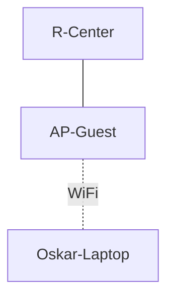

# 9. Guest WiFi ehitamine

::: info Õpiväljund
Pärast kohtumist oskad lisada eraldi aadressivahemikuga juhtmevaba külalisvõrgu, seadistada WiFi kaitse ning kontrollida, et külaline saab aadressi ja avab olemasoleva sisemise serveri lehe.
:::

## Mis Karli keskuses nüüd juhtub?

Oskar tuleb keskusesse oma sülearvutiga ja küsib: "Mis on WiFi parool?" Karl kaalub tema ühendamist Staff võrku. Mirjam juhib tähelepanu, et siis jõuaks külaline ka töötajate serverini. Senises laboris on Staff seadmed kaabliga; nüüd lisame külaliste jaoks esimese WiFi-pääsupunkti.

Karl otsustab: **külalistele oma võrk**. Täna ehitame selle. **Aga:** ehitamine ei ole veel kaitse. Selle kohtumise lõpuks on külalisvõrk eraldi, aga **ligipääsupiirang** tuleb kohtumisel 10. Seda võrku ei nimeta me veel turvaliseks.

## Mida vaja on

| Osa | Mida teeb |
| --- | --- |
| **Pääsupunkt** (*access point*) | Raadiosignaal, mis ühendab külalise sülearvuti kaabelvõrguga |
| **SSID** | WiFi-võrgu nimi, mida külaline näeb |
| **WPA2** | Kaitse: ilma õige paroolita ei saa ühendust. See krüpteerib ka sõnumid |
| **Ruuteri kolmas liides** | Guest võrgu oma ühendus ruuteriga |

SSID nimi **ei eralda** võrku. "Guest" nimega WiFi võib olla samas võrgus Mirjami arvutiga. Eraldab alles see, et pääsupunkt on ühendatud **eraldi ruuteri liidesega** ja sellel on oma aadressivahemik.

## Ehitamine

Ava oma `08-observation.pkt` ja salvesta koopia nimega `09-guest.pkt`. Kontrolli, et Gaming ja Staff kliendid on endiselt DHCP-l ning `http://gaming.test` avaneb. Välist serverit selles etapis veel pole.

Guest kasutab **selle tunni jooksul sisemist DNS-i `192.168.20.10`**. Välise DNS-serveri ehitad ise [praktilises töös 9A](./valise-testvorgu-ehitamine) ning muudad siis Guest DNS-aadressi. Staff ligipääsu keelame alles pärast seda.

Kontrolli, et ruuteri kolmas LAN-liides on Guest jaoks vaba. Allpool on näidisnimi `GigabitEthernet0/2`: leia tegelik nimi ruuteri portide juurest või `show ip interface brief` väljundist. Gaming ja Staff kaablid jäävad oma kohtadele.



1. Lisa **Network Devices → Wireless Devices** alt pääsupunkt (nimi `AP-Guest`).
2. Ühenda `AP-Guest` ruuteri **kolmanda liidesega** (`GigabitEthernet0/2`) sirge kaabliga. **Ära** ühenda seda `SW-Staff` kommutaatorisse. See oleks sama võrk.
3. Lisa **End Devices → Laptop**, nimi `Oskar-Laptop`.

### Sülearvuti WiFi-moodul

Packet Traceri vaikimisi sülearvutil ei pruugi olla juhtmevaba moodulit. Kui nii on:

1. Ava sülearvuti → **Physical** vaade.
2. Lülita sülearvuti välja (toitenupp).
3. Eemalda olemasolev võrgumoodul ja lisa **WiFi-moodul** (nt WPC300N).
4. Lülita sülearvuti tagasi sisse.

### Ruuteri Guest liides

Anname Guest võrgule oma liidese ja oma DHCP pooli. See on sama, mida tegid kohtumistel 5 ja 6, nii et kirjuta käsud ise.

**Samm 1: liides.** Seadistamise režiimis (`enable`, `configure terminal`) anna kolmandale liidesele Guest võrgu gateway:

```text
interface GigabitEthernet0/2
ip address 192.168.30.1 255.255.255.0
no shutdown
exit
```

Kontrollimiseks anna `end` ja seejärel `show ip interface brief`: Guest liides peab olema **up / up**. Seejärel mine käsuga `configure terminal` tagasi üldseadistusse, et lisada välistused.

**Samm 2: välistused.** Välista `.1–.20` ja `.201–.254`, nagu teistes võrkudes:

```text
ip dhcp excluded-address 192.168.30.1 192.168.30.20
ip dhcp excluded-address 192.168.30.201 192.168.30.254
```

**Samm 3: pool.** Loo pool nimega `GUEST`. Võrk on `192.168.30.0 255.255.255.0` ja gateway `192.168.30.1`:

```text
ip dhcp pool GUEST
network 192.168.30.0 255.255.255.0
default-router 192.168.30.1
```

**Samm 4: DNS.** Kasuta praegu olemasoleva sisemise serveri aadressi:

```text
dns-server 192.168.20.10
exit
end
```

See annab Oskarile sama DNS-i nagu Gaming ja Staff klientidele. DNS-teenus peab `SRV-Staff` seadmel olema sisse lülitatud.

### Pääsupunkti WiFi

1. Ava `AP-Guest` → **Config** → vali WiFi-port.
2. **SSID**: `Karli-Guest`.
3. **Authentication**: **WPA2-PSK**.
4. **Passphrase**: vali labori jaoks mõeldud parool. Ära kasuta oma päris parooli ega Interneti-teenuse parooli.
5. Kontrolli, et pääsupunkt on sisse lülitatud.

### Külalise sülearvuti

1. Ava `Oskar-Laptop` → **Desktop** → **PC Wireless**.
2. Vali **Connect**, leia `Karli-Guest`, sisesta parool.
3. Veendu, et sülearvuti seadistus on **DHCP**.

## Kontroll

Oskari sülearvutil:

```text
ipconfig
```

- Aadress peab olema `192.168.30.x` (vahemikus `.21–.200`).
- Mask peab olema `255.255.255.0`.
- Vaikelüüs peab olema `192.168.30.1`.
- DNS peab olema praegu `192.168.20.10`; kontrolli seda **IP Configuration** vaates.

Ruuteril kontrolli haldaja režiimis `show ip dhcp binding` ja `show ip dhcp pool`: leia Oskari tegelik aadress ning pool `GUEST`. Pooli nimi on silt; õige alamvõrgu valib server päringu saabumise liidese järgi.

Ava Oskari brauseris kõigepealt `http://192.168.20.10`, seejärel `http://gaming.test`. Mõlemad peavad avanema. Kui IP töötab, aga nimi mitte, kontrolli DNS-aadressi ja serveri DNS-teenust.

**See on veel piiramata külalisvõrk.** Oskar pääseb Staff serverisse ja kasutab sealset DNS-i. Kirjuta see tulemus üles. Töö 9A käigus lisame välise teenuse ja vahetame Guest DNS-i; kohtumisel 10 keelame ligipääsu sisevõrkudesse.

## Mis juhtuks, kui…

Salvesta esmalt toimiv fail. Proovi koopia peal ühte viga korraga ja kirjuta, mida Oskar näeks:

| Muudatus | Mida näed | Mida see Oskarile tähendab |
| --- | --- | --- |
| Sülearvutis on vale WiFi parool | Ühendus ei õnnestu, aadressi ei tule | "WiFi ei võta mind vastu" |
| Guest DHCP pool puudub või `default-router` on vale | Sülearvuti ühendub WiFi-ga, aga aadressi ei saa või Staff serverisse ei pääse | "WiFi on olemas, aga serveri leht ei avane" |

Esimene viga on **WiFi kaitse** küsimus, teine **võrgu** küsimus. Mängija, töötaja ja külaline ei eristaks neid, aga Karl peab.

Vale lüüsi katsel küsi pärast pooli muutmist kliendil **Static → DHCP** abil uus seadistus ja kontrolli tegelikku lüüsi. Pärast iga katset taasta seaded, ühenda õige WiFi parooliga ja uuenda vajadusel DHCP-seadistust. Enne järgmisele kohtumisele minekut peavad õige IP, mask, lüüs ja sisemine DNS ning sisemise lehe avamine taas töötama.

## Esialgne riskikirjeldus

Nüüd, kui külalisvõrk töötab, kirjuta üles **esimene risk**:

| Mis võiks juhtuda | Kes kannatab | Mis on nõrk koht | Mis aitaks |
| --- | --- | --- | --- |
| Külaline pääseb Staff serverisse | Mirjam, mängijad | Guest ja Staff võrgu vahel ei ole piirangut | Piirangu reegel (kohtumine 10) |

## Esitatav töö

- Fail `09-guest.pkt`.
- Guest parameetrite tabel: IP, mask, gateway, DNS, SSID, krüpteering.
- Ekraanipilt või kirjeldus, kuidas külaline avas sisemise lehe IP ja nime kaudu.
- Esimene risk (tabel ülal).
- Taastatud toimiv fail; Gaming ja Staff kliendid ning nende sisemine DNS jäävad eelmise tunni seadistusse. Salvesta ruuteri seadistus käsuga `copy running-config startup-config` ja seejärel `.pkt` fail.

## Kokkuvõte

| Mõiste | Tähendus |
| --- | --- |
| Pääsupunkt | Juhtmevaba seade, mis ühendab külalised kaabelvõrguga |
| SSID | WiFi võrgu nimi |
| WPA2 | Krüpteering ja parool WiFi kaitseks |
| Guest võrk | Eraldi võrk, oma aadressivahemik (192.168.30.0/24) |

## Järgmine samm

Jätka oma failiga [töös 9A: ehitame välise testvõrgu](./valise-testvorgu-ehitamine). Alles pärast selle valmimist mine külalisvõrgu piirangute juurde.
