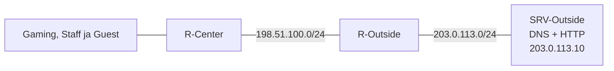

# 9A. Ehitame ise välise testvõrgu

::: info Õpiväljund
Pärast tööd oskad juhendi abil ühendada oma keskuse välise testserveriga ning kontrollida selle lehte IP ja nime kaudu.
:::

See on **eraldi praktiline töö enne kohtumist 10**. Arvesta selleks omaette 90-minutiline tööaeg; ära lisa seda piirangute tunni sisse. Ehitad kõike **oma senises failis**. Õpetaja valmisfaili ega õpetajalt saadavaid serveriaadresse pole vaja.

Meie „välisvõrk” on Packet Traceri sisse ehitatud testvõrk, mitte päris internet. Uus server pakub nii veebilehte kui ka DNS-i. Nii jääb Oskarile pärast Staff võrgu keelamist alles oma kasutatav DNS.

## 1. Ava oma võrk ja vaata, mida lisad

Ava `09-guest.pkt`, salvesta koopia nimega `09a-external.pkt`. Kontrolli, et Oskar saab DHCP-aadressi ja avab praegu `http://gaming.test`.



**Ennusta:** server peab vastuse sinu arvutile tagasi saatma. Kas ainult keskruuteri teadmisest „kus server asub” piisab?

### Kõik selle töö aadressid

| Seade ja ühendus | IP | Mask | Vaikelüüs |
| --- | --- | --- | --- |
| R-Center ühendus teise ruuteriga | `198.51.100.1` | `255.255.255.0` | — |
| R-Outside ühendus keskruuteriga | `198.51.100.2` | `255.255.255.0` | — |
| R-Outside serveripoolne liides | `203.0.113.1` | `255.255.255.0` | — |
| SRV-Outside | `203.0.113.10` | `255.255.255.0` | `203.0.113.1` |

Välise DNS-i IP on **`203.0.113.10`**, välise veebilehe nimi **`valis.test`**. Need on selle juhendi kindlad väärtused. `198.51.100.0/24` ja `203.0.113.0/24` on dokumentatsiooniks reserveeritud näidisvõrgud.

## 2. Lisa kaks seadet ja ruuterite vaheline ühendus

Gaming, Staff ja Guest kasutavad juba keskruuteri kolme LAN-liidest. Nende kaableid ära eemalda. Lisame ruuterite vahele eraldi **serial-ühenduse**, et olemasolevad LAN-id säiliksid.

1. Lisa **Network Devices → Routers → 2911** ja nimeta see `R-Outside`.
2. Lisa **End Devices → Server**, nimeta `SRV-Outside`.
3. Salvesta **R-Center** senine seadistus CLI-s: `enable`, seejärel `copy running-config startup-config`. Kinnita sihtnimi Enteriga. Salvesta ka `.pkt` fail, sest järgmises sammus lülitad ruuteri korraks välja.
4. Ava R-Center **Physical** vaade, lülita toide välja, lisa vabasse sobivasse pessa serial-moodul ja lülita toide sisse. **2911 puhul kasuta `HWIC-2T` moodulit.** Tee sama uuel R-Outside 2911 ruuteril.
5. Kui senine keskruuter on üldine **Router-PT**, kasuta sellel `PT-ROUTER-NM-1S` moodulit. Mõlemal juhul paigalda moodul toide väljas. Mooduli kirjeldus Physical vaates peab nimetama serial-liidest. Ära kasuta Etherneti kommutaatorimoodulit serial-mooduli asemel.
6. Vali **Connections → Serial DCE** kaabel. Klõpsa esmalt R-Center serial-porti ja seejärel R-Outside serial-porti. Kirjuta valitud portide nimed üles.
7. Ühenda R-Outside **GigabitEthernet0/0** serveri **FastEthernet0** porti. Kasuta ühenduste ribal automaatset kaablivalikut (*Automatically Choose Connection Type*).

Kui uus ruuter küsib CLI avamisel `Continue with configuration dialog?`, vasta `no` ja vajuta Enter.

::: tip Leia tegelikud liidesenimed
Käivita mõlemal ruuteril `enable` ja `show ip interface brief`. Allpool kasutame mõlemal **`Serial0/0/0`** näidet. Mooduli pesa järgi võib nimi olla näiteks `Serial0/1/0` või Router-PT puhul `Serial3/0`. Kasuta igas selle ruuteri käsus oma üles kirjutatud nime. Kui serial-liidest üldse ei ilmu, kontrolli toite väljalülitamist, mooduli sobivust ja paigaldust enne jätkamist. Muud mudelid võivad vajada teist serial-moodulit; küsi vajadusel abi mooduli valimisel, mitte valmis võrgufaili.
:::

## 3. Anna ruuterite ühendusele aadressid

**R-Center CLI-s**, haldaja režiimist `R-Center#`:

```text
configure terminal
interface Serial0/0/0
ip address 198.51.100.1 255.255.255.0
no shutdown
end
```

**R-Outside CLI-s**, haldaja režiimist:

```text
configure terminal
hostname R-Outside
interface Serial0/0/0
ip address 198.51.100.2 255.255.255.0
no shutdown
exit
interface GigabitEthernet0/0
ip address 203.0.113.1 255.255.255.0
no shutdown
end
```

`interface` valib pesa, `ip address` annab sellele aadressi ja `no shutdown` lülitab ühenduse sisse. Need on samad võtted nagu esimestes LAN-ides.

### Serial-kaabli üks eripära

Üks kaabliots on **DCE** ja annab ühendusele ajastuse. Vaata mõlemal ruuteril käsuga `show controllers serial 0/0/0`, kumb ots näitab **DCE** (kasuta oma tegeliku liidese numbreid). Esimesena ühendatud R-Center peaks olema DCE; kinnita see väljundist.

**Ainult DCE-otsa ruuteril** anna:

```text
configure terminal
interface Serial0/0/0
clock rate 64000
end
```

See on simuleeritud serial-lingi ajastus. Arvu ei pea tuletama ega pähe õppima. Kui DCE on teisel ruuteril, anna käsk seal. DTE-otsal seda vaja pole.

**Kontroll:** mõlema ruuteri `show ip interface brief` peab näitama serial-linki **up / up**. R-Center käsust `ping 198.51.100.2` peavad tulema vastused. Kui link ei tööta, kontrolli kõigepealt kaabliotsi, aadresse, `no shutdown` ja DCE ajastust.

## 4. Pane väline server tööle

Ava **SRV-Outside → Desktop → IP Configuration → Static**:

| Väli | Väärtus |
| --- | --- |
| IP | `203.0.113.10` |
| Mask | `255.255.255.0` |
| Default Gateway | `203.0.113.1` |
| DNS Server | `203.0.113.10` |

1. Ava **Services → HTTP**, vali **On**. Muuda `index.html` tekstiks näiteks „Väline testleht töötab” ja salvesta see **Save** nupuga. Erinev tekst aitab eristada välist ja sisemist lehte.
2. Ava **Services → DNS**, vali **On**. Lisa **A-kirje**: Name `valis.test`, Address `203.0.113.10`, vajuta **Add**.
3. R-Outside ruuteril proovi `ping 203.0.113.10`. See peab juba töötama, sest server on tema otse ühendatud võrgus.

**Proovi enne järgmist sammu:** kas Oskari brauseris `http://203.0.113.10` juba avaneb? Kirjuta tulemus üles. Ruuterite omavaheline ühendus üksi ei anna neile veel kõigi võrkude teekondi.

## 5. Lisa tee välja ja vastuse tee tagasi

**R-Center** peab teadma, et serverivõrku pääseb teise ruuteri kaudu:

```text
configure terminal
ip route 203.0.113.0 255.255.255.0 198.51.100.2
end
```

Loe käsku: „Võrku `203.0.113.0/24` mine järgmise ruuteri `198.51.100.2` kaudu.” `ip route` lisab marsruudi ehk teekonna juhise.

**R-Outside** peab oskama vastused kõigisse kolme keskuse LAN-i tagasi saata:

```text
configure terminal
ip route 192.168.10.0 255.255.255.0 198.51.100.1
ip route 192.168.20.0 255.255.255.0 198.51.100.1
ip route 192.168.30.0 255.255.255.0 198.51.100.1
end
```

Iga rida tähendab: „Sellesse LAN-i mine R-Centeri kaudu.” Tagasitee on sama oluline kui väljuva päringu tee.

**Kontroll:** vaata mõlemal ruuteril `show ip route`. Lisatud teekonna ees peaks olema **S** (*static*). Proovi Oskarilt ning ühelt Gaming ja Staff kliendilt `ping 203.0.113.10` ja ava `http://203.0.113.10`. Korda esimest pingi vajadusel ARP tõttu.

### Miks me ei seadista NAT-i?

See on suletud õppelabor: R-Outside teab meie privaataadressidega LAN-ide tagasiteid. NAT-i pole selleks vaja. Päris avalikus internetis privaataadresse ei marsruudita; seal kasutatakse sageli aadressitõlget. Päris internetiga liitumist me siin ei ehita. Ära lisa oma failile oletatavat „õpetaja NAT-i seadistust”.

## 6. Anna külalisele väline DNS

Oskar kasutab seni Staff DNS-i `192.168.20.10`. See ei jää pärast Staff võrgu keelamist kättesaadavaks. **Muuda ainult Guest pooli**, Gaming ja Staff jäävad oma DNS-i kasutama.

R-Center ruuteril:

```text
configure terminal
ip dhcp pool GUEST
no dns-server 192.168.20.10
dns-server 203.0.113.10
end
```

Esimene DNS-rida eemaldab vana aadressi, teine määrab uue. See käsk ei muuda ruuteri ega serveri IP-d.

1. Oskaril vali **Desktop → IP Configuration → Static → DHCP**, et seadistus uuesti küsida.
2. Kontrolli: IP jääb `192.168.30.21–.200`, mask `255.255.255.0`, lüüs `192.168.30.1`, **DNS on nüüd `203.0.113.10`**.
3. Ava Oskari brauseris `http://valis.test`. Peab ilmuma sinu välise serveri leht.
4. Lisa **sisemise SRV-Staff serveri DNS-i** samuti A-kirje `valis.test` → `203.0.113.10`. Gaming ja Staff kliendid saavad nüüd välist testnime kasutada oma olemasoleva DNS-i kaudu. Nende DHCP-poole ära muuda.

Kummalgi DNS-il on oma kirjed. Sisemine DNS tunneb endiselt `gaming.test`; Guest välisel DNS-il pole seda sisemist nime vaja.

## 7. Kontrolli valmis võrku

| Kust ja mida kontrollid? | Oodatav tulemus | Tegelik tulemus |
| --- | --- | --- |
| Oskar: DNS-aadress IP Configuration vaates | `203.0.113.10` | |
| Oskar: `http://203.0.113.10` | Väline leht avaneb | |
| Oskar: `http://valis.test` | Sama väline leht avaneb | |
| Gaming klient: `http://gaming.test` ja `http://valis.test` | Mõlemad avanevad | |
| Staff klient: `http://gaming.test` ja `http://valis.test` | Mõlemad avanevad | |
| Oskar: `http://192.168.20.10` | Praegu veel avaneb | |

Kui väline **IP töötab, aga nimi mitte**, kontrolli DNS-kirjet ja kliendi DNS-aadressi. Kui IP ei tööta, kontrolli liideseid, serveri lüüsi ning **mõlema ruuteri marsruute**. Ruuterite serial-aadresside ping aitab eristada ühenduse ja marsruutide probleemi.

Salvesta mõlema ruuteri seadistus käsuga `copy running-config startup-config`. Salvesta oma `09a-external.pkt` ja ava see uuesti kontrollimiseks.

## Esitatav töö

- Oma ehitatud `09a-external.pkt`, lisatud ruuteri ja serveriga.
- Täidetud lõppkontrolli tabel ja kasutatud liideste nimed.
- Üks lause: miks oli R-Outside ruuterile vaja keskuse LAN-ide tagasiteid?

Edasi ava [kohtumine 10: külalisvõrgu piirang](./kohtumine-10-guest-eraldamine-ja-koormus). Seal jätkad sellest failist. Õpetaja ei pea sulle ühtegi võrguosa ega DNS-aadressi juurde andma.

## Tehnilised allikad

- [Packet Traceri ruuterite ja moodulite ametlik abi](https://tutorials.ptnetacad.net/help/default/devicesAndModules_routers.htm) — ruuterimudelitele sobivad moodulid.
- [Cisco staatiliste marsruutide juhend](https://www.cisco.com/c/en/us/support/docs/dial-access/floating-static-route/118263-technote-nexthop-00.html) — marsruudi järgmise hüppe tähendus.
