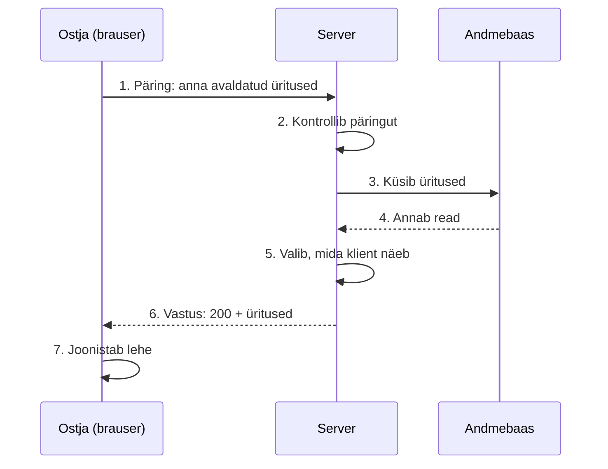

# 1. Päringu ja vastuse tsükkel

::: info Õpiväljund
Pärast seda lehte oskad kirjeldada, mis juhtub veebirakenduses ühe klõpsu ajal, tunned ära päringu ja vastuse osad ning oskad öelda, mida tähendavad staatusekoodid `200`, `404` ja `500`.
:::

## Olukord

Ostja avab piletirakenduse lehe, kus on loetletud tulevased kontserdid. Ta ei kirjuta midagi, ainult avab lehe, ja ekraanile ilmub kolm üritust.

Kust need kolm üritust tulid? Ostja ei tea, ja ta ei pea teadma. Aga **rakenduse ehitajal** tuleb see teada, sest iga viga (tühi nimekiri, vale hind, aeglane leht) tekib kuskil selle teekonna sees.

## Võrdlus: restoran

Külaline istub restoranis ja ütleb ettekandjale: "Palun menüü." Ettekandja läheb kööki, tuleb tagasi ja toob menüü. Külaline ei näe, mida köögis tehti.

| Restoranis | Rakenduses |
| --- | --- |
| Külaline | **Klient** (brauser) |
| Ettekandja viib sõnumi ja toob vastuse | **Võrk** (internet) |
| Köök | **Server** (rakendus) |
| "Palun menüü" | **Päring** (*request*) |
| Menüü lauale | **Vastus** (*response*) |

**Kus võrdlus ei kehti:** päris restoranis ettekandja tunneb sind, kui oled seal teist korda. Veebiserver **ei tunne**. Iga päring on tema jaoks esimene. Sellest tuleb allpool lähemalt.

## Teekond



| Samm | Mis juhtub | Kes teeb |
| --- | --- | --- |
| 1 | Brauser saadab päringu aadressile | Brauser |
| 2 | Server vaatab, kas päring on korras ja kas kliendil on luba | Server |
| 3–4 | Server küsib andmed andmebaasist | Server ja andmebaas |
| 5 | Server paneb kokku vastuse ja jätab välja selle, mida klient ei tohi näha | Server |
| 6 | Server saadab vastuse | Server |
| 7 | Brauser teeb vastusest ekraanil oleva lehe | Brauser |

Kogu teekond võtab tavaliselt sekundi murdosa. Selles moodulis vaatame sammude 2–5 sisse: mis seal toimub ja kuidas seda korraldada.

## Päring

Päring koosneb neljast osast.

| Osa | Mida ütleb | Näide |
| --- | --- | --- |
| **Meetod** | Mida klient tahab teha | `GET` (anna mulle) |
| **Aadress** | Millega | `/api/public/events` |
| **Päised** | Lisateave (kes ma olen, mis keeles tahan vastust) | `Accept: application/json` |
| **Keha** | Andmed, mida klient saadab (mitte kõigil päringutel) | Uue ürituse andmed |

Meetodeid on mitu, ja need ütlevad kavatsust:

| Meetod | Mõte | Näide |
| --- | --- | --- |
| `GET` | Lugemine, ei muuda midagi | Näita üritusi |
| `POST` | Uue loomine või tegevus | Loo üritus, avalda üritus |
| `PUT` | Terve asja asendamine | Asenda ürituse andmed |
| `DELETE` | Kustutamine | Kustuta mustand |

## Vastus

Vastus koosneb samuti neljast osast: **staatusekood**, päised, keha ja (tihti) andmed JSON-kujul.

```text
200 OK
Content-Type: application/json

[
  { "title": "Sügiskontsert", "city": "Kuressaare", "startsAt": "2026-11-14T18:00:00.000Z" }
]
```

**Staatusekood** on kolmekohaline number, mis ütleb kohe, kas läks hästi:

| Rühm | Tähendus | Näited |
| --- | --- | --- |
| `2xx` | Läks hästi | `200` OK, `201` loodud, `204` tehtud, tagastada pole midagi |
| `4xx` | **Klient** tegi vea | `400` vigane päring, `401` pole sisse logitud, `403` ei tohi, `404` ei leitud, `409` konflikt |
| `5xx` | **Server** tegi vea | `500` midagi läks katki |

`4xx` ja `5xx` vahe on oluline, sest see ütleb, kes peab asja parandama. Kui ostja kirjutab aadressi valesti ja saab `404`, on viga tema poolel. Kui server annab `500`, siis on viga ehitajal.

::: tip Näide meie rakendusest
Ostja avab mustandis oleva ürituse aadressi. Server vastab `404` ("ei leitud"), mitte `403` ("ei tohi"). Miks? `403` reedaks, et selline mustand **on olemas**. `404` ütleb ainult: "sellist avalikku üritust pole".
:::

## Server ei mäleta

Ostja avas ürituste lehe ja klõpsas siis ühel üritusel. Brauser saatis **uue** päringu. Server ei tea, et see on sama inimene, kes äsja nimekirja vaatas. **Iga päring on iseseisev.** Seda omadust nimetatakse *stateless* ("olekuta").

Miks nii? Sest see teeb serveri lihtsaks ja skaleeritavaks: kui tuleb sada tuhat inimest, võib päringuid jagada paljude serverite vahel ja ükski neist ei pea ühtegi inimest meeles pidama.

Aga kuidas siis rakendus teab, et kasutaja on sisse logitud? Brauser **saadab igal päringul kaasa tõendi** (selle kohta tuleb eraldi leht sisselogimisest). Server ei mäleta kasutajat, vaid kontrollib tõendit igal korral uuesti.

## Katseta: saada päring

Alusta avaliku nimekirjaga. Siis proovi korraldaja nimekirja sisse logimata, ostjana ja korraldajana. **Ennusta enne saatmist** staatusekood ja seda, kas server peab andmebaasilt küsima.

<RequestSimulator />

Märka kahte asja. Esiteks: kaitstud aadressil küsib server sessiooni andmebaasist **igal päringul uuesti**, sest ta ei mäleta eelmist päringut. Teiseks: `401` ja `403` erinevad. `401` tähendab "ma ei tea, kes sa oled", `403` tähendab "tean, aga sa ei tohi".

## Mis juhtuks ilma?

Kujuta ette, et poleks kokkulepitud päringu ja vastuse kuju. Iga brauser ja iga server teeks oma moodi, ükski leht ei töötaks ühegi serveriga. **HTTP** on see kokkulepe, mida kõik brauserid ja serverid järgivad. Tänu sellele saab rakenduse frontend'i teha eraldi inimene, kes backend'i koodi ei näe: neil on vaja kokku leppida ainult päringute ja vastuste kujus.

## Kuidas see meie koodis välja näeb

::: details Lühike koodinäide (võib vahele jätta)
Server ütleb: "kui tuleb `GET` aadressile `/api/public/events`, siis tee seda":

```ts
// Aadress ja tegevus kokku
publicEventRouter.get("/", eventController.findAllPublished);

// Tegevus: võta päring, küsi andmed, saada vastus
findAllPublished = async (req, res) => {
    const events = await service.findAllPublished();
    res.json(events); // staatusekood 200 on vaikimisi
};
```

Siin on ainult kolm asja: **aadress**, **funktsioon, mis seda teenindab**, ja **vastus**. Ülejäänud (kontroll, andmebaas, vastuse kuju) toimub vahepeal. Sellest räägime järgmistel lehtedel.
:::

::: details Proovi ise brauseris
Ava brauseris arendaja tööriistad (F12) → **Network** (võrk). Ava mõni leht ja vali päring: näed meetodit, aadressi, staatusekoodi ja vastust, täpselt nii nagu siin kirjeldatud.
:::

## Kontrollküsimused

1. Ostja saab vastuseks `404`. Kelle viga see on, ostja või serveri?
2. Miks server ei tohi eeldada, et teab, kes kasutaja on, kui ta sama päeva jooksul juba üks kord päringu saatis?
3. Mis vahe on meetodil `GET` ja `POST`?

::: details Vastused
1. **Kliendi** (`4xx`): ta küsis midagi, mida pole (või mida ta ei tohi näha, vt mustandi näidet). Kui server oleks katki, oleks staatus `5xx`.
2. Sest iga päring on iseseisev (*stateless*). Server ei mäleta eelmist päringut. Kasutaja tuvastatakse igal päringul kaasa antud tõendi põhjal.
3. `GET` loeb ega muuda midagi, `POST` loob midagi uut või käivitab tegevuse (nt "avalda üritus").
:::
