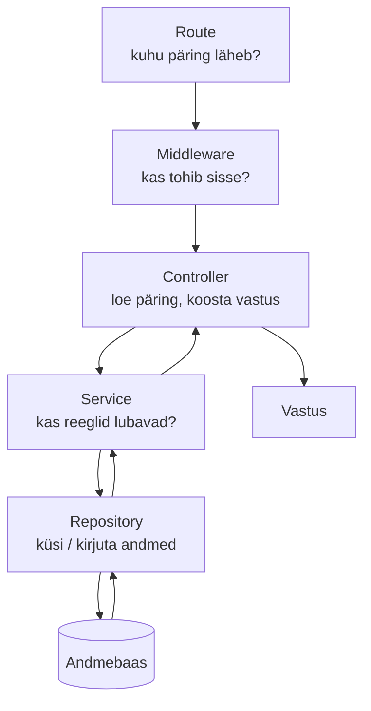

# 2. Kihid: kes mida teeb?

::: info Õpiväljund
Pärast seda lehte oskad nimetada backend'i viit kihti, öelda, mis on igaühe töö, ning otsustada, millisesse kihti üks konkreetne reegel kuulub.
:::

## Olukord

Korraldaja tahab ürituse **avaldada**, et see ilmuks avalikku nimekirja. Ta vajutab nuppu "Avalda". Vaja on kontrollida mitut asja:

- Kas kasutaja on üldse **sisse logitud**?
- Kas ta on **korraldaja** (mitte tavaline ostja)?
- Kas see üritus on **tema enda** oma?
- Kas üritus on **mustand**? Juba tühistatud üritust ei tohi enam avaldada.
- Ja alles siis: **kirjuta andmebaasi**, et üritus on avaldatud.

Kui kirjutaksid kõik need kontrollid ja andmebaasi päringu **ühte suurde funktsiooni**, saaks see töötada. Aga üsna pea läheks asi käest ära.

## Mis juhtuks ilma?

Kujuta ette ühte funktsiooni, mis teeb kõike: loeb päringu, kontrollib sisselogimist, kontrollib omanikku, kirjutab SQL-i, ja koostab vastuse. Probleemid:

- **Muutmine on hirmus.** Tahad andmebaasi vahetada? Pead läbi vaatama kõik funktsioonid, kus on SQL-i.
- **Reegleid on mitmes kohas.** "Tühistatud üritust ei saa avaldada" on kirjas kolmes funktsioonis. Neljandas unustatakse. Nüüd saab mõni tee reegli rikkuda.
- **Testimine on raske.** Reegli proovimiseks tuleb käivitada terve server ja andmebaas.
- **Keegi ei leia midagi üles.** Kus see kontroll on? Kõikjal.

## Võrdlus: restoran

Hea restoran ei lase ettekandjal süüa teha ega kokal klientidega vaielda. Igaühel on **üks töö**:

| Restoranis | Töö | Backend'is | Töö |
| --- | --- | --- | --- |
| Uks ja turvamees | Kontrollib, kes võib sisse | **Middleware** | Kontrollib päringut enne töötlemist (sisselogimine, roll) |
| Ettekandja | Võtab tellimuse vastu, toob roa | **Controller** | Loeb päringu, annab töö edasi, koostab vastuse |
| Kokk | Teab retsepte ja reegleid | **Service** | Äriloogika: mis tohib ja mis mitte |
| Laohoidja | Teab, kust midagi leida | **Repository** | Ainus, kes räägib andmebaasiga |
| Ladu | Hoiab toorainet | **Andmebaas** | Hoiab andmeid |

Lisaks on **route** ehk "menüü": see määrab, milline ettekandja milliseid tellimusi võtab (`POST /events/:id/publish` → "avalda"-ettekandja).

**Kus võrdlus ei kehti:** restoranis võib kokk vahel ise lauda minna. Koodis hoiame piiri **teadlikult**, sest muidu kaob kihtide mõte.

## Teekond



Päring läheb allapoole, vastus tuleb sama teed tagasi.

## Katseta: avalda üritus

Jälgi esmalt oma mustandi edukat avaldamist. Seejärel muuda ürituse olekuks **tühistatud** ja proovi uuesti. **Ennusta enne päringu saatmist**, kus tegevus katkeb ja kas andmebaasi kirje muutub.

<PublishSimulator />

Märka, et service kasutab repository't rohkem kui üks kord: esmalt küsib ta andmed reeglite kontrollimiseks ja alles siis tellib lubatud muudatuse. **Andmete lugemine ei ole sama mis nende muutmine.** Vea korral koostatakse HTTP-vastus eraldi veatöötluses.

## Kes mida kontrollib?

"Avalda" päring läbib kihte:

| Küsimus | Kiht | Miks just seal? |
| --- | --- | --- |
| Kas päring jõuab õigesse kohta? | **Route** | See on aadresside kaart |
| Kas kasutaja on sisse logitud? Kas ta on korraldaja? | **Middleware** | Sama kontroll kehtib kõigile korraldaja aadressidele, kirjutame ühe korra |
| Kas aadressis olev ürituse number on õige kujuga? | **Controller** | Kontroll, mis puudutab ainult päringu kuju |
| Kas see on **tema enda** üritus? Kas see on mustand? | **Service** | Need on rakenduse reeglid, mitte HTTP ega SQL |
| Kus ja kuidas üritus andmebaasis seisab? | **Repository** | Ainus, mis teab tabelite nimesid |

**Reeglite lihtne test:** kui kujutad ette, et sama reegel kehtiks ka siis, kui rakendus oleks mobiilirakendus, mitte veebileht, kuulub see **service'i**. Kui reegel on seotud HTTP-ga (päis, staatusekood), kuulub see controller'isse või middleware'i.

## Mis muutub tänu kihtidele?

| Soov | Mida muudad | Mida ei pea puutuma |
| --- | --- | --- |
| Andmebaasi vahetus | Repository | Reeglid, aadressid, vastused |
| Uus reegel ("avalda saab enam kui nädal enne algust") | Service | Aadressid, SQL |
| Uus aadress | Route ja controller | Reeglid, SQL |
| Reegli proovimine | Service'i test (andmebaasita) | Server, andmebaas |

## Kuidas see meie koodis välja näeb

::: details Näide: "Avalda üritus" (võib vahele jätta)
**Route**: aadress ja kaitse.
```ts
eventRouter.use(requireAuth, requireRole("organizer")); // middleware: kõigile korraldaja aadressidele
eventRouter.post("/:id/publish", eventController.publish);
```

**Controller**: loeb päringu, kutsub service'it, vastab. Reegleid pole.
```ts
publish = async (req, res) => {
    const {id} = eventIdParams.parse(req.params);
    const event = await service.publish(id, req.user);
    res.json(toEventResponse(event));
};
```

**Service**: reeglid, ei tea HTTP-st ega SQL-ist midagi.
```ts
async publish(id, user) {
    const event = await this.findOwnedById(id, user);        // kas on minu oma?
    if (event.status !== "draft") {
        throw new ConflictError("Seda üritust ei saa avaldada"); // reegel
    }
    return this.repository.update(id, {status: "published"});
}
```

**Repository**: ainus koht, kus andmebaasi päringud elavad.
```ts
async update(id, values) {
    const [row] = await db.update(events).set(values).where(eq(events.id, id)).returning();
    return row;
}
```

Märka: service viskab `ConflictError`, aga ei tea, et see tähendab HTTP-staatust `409`. See tõlgitakse vastuseks **ühes kohas** (veatöötluses), mitte igas funktsioonis.
:::

## Kas peab alati olema viis kihti?

Ei pea. See on **tava**, mitte seadus. Väga väikeses rakenduses (kolm aadressi, ilma reegliteta) võib service jääda ära. Kihid hakkavad end tasuma, kui rakendus kasvab ja reegleid tuleb juurde. Nimetused varieeruvad: Spring ütleb `@RestController`, `@Service`, `@Repository`, Laravel ütleb *controller*, *model*, *service class*, aga mõte on sama: **igal tööl on oma koht.**

## Kontrollküsimused

1. Tahad lisada reegli: "ürituse saab avaldada ainult siis, kui sellel on vähemalt üks piletitüüp". Millisesse kihti see kuulub?
2. Tahad andmebaasi vahetada PostgreSQL-ilt teisele. Millist kihti peaks muutma?
3. Controller'is on `if (event.organizerId !== user.id)` kontroll. Mis on selle puudus?

::: details Vastused
1. **Service**. See on rakenduse reegel, mis kehtiks ka siis, kui päring ei tuleks veebist.
2. **Repository**. Ainult seal on andmebaasi päringud. Kui teised kihid on puhtad, ei pea neid muutma.
3. Reegel on nüüd controller'is, ehk seotud HTTP-kihiga. Kui sama reegel on vaja mõnel teisel kohal (nt taustatöös), peab selle uuesti kirjutama, ja kuhugi unustatakse ära. Õige koht on service.
:::
