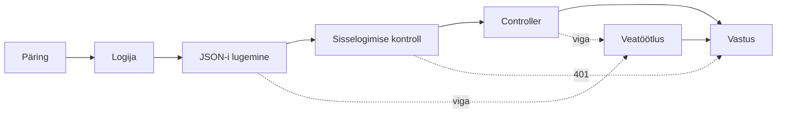

# 4. Middleware ja veatöötlus

::: info Õpiväljund
Pärast seda lehte oskad selgitada, mis on middleware ja mida see võib päringuga teha, põhjendada middleware'ide järjekorda ning kirjeldada, kuidas veast saab ühes kohas õige staatusekoodiga vastus.
:::

## Olukord

Enne kui controller saab ürituse luua, peab iga päringuga juhtuma mitu asja:

- päring tuleb **logisse** kirja panna (ka siis, kui see hiljem tagasi lükatakse);
- päringu keha tuleb **lugeda** tekstist objektiks;
- tuleb **kontrollida**, kas kasutaja on sisse logitud.

Ja kui kuskil läheb midagi valesti, peab klient saama **korraliku vastuse**: õige staatusekood ja arusaadav teade, mitte serveri sisemine veateade.

Need tööd on vaja teha **peaaegu igal päringul**. Kui kirjutaksid need igasse controller'isse eraldi, oleks sama kood sadas kohas, ja kuskil jääks see kindlasti ära.

## Võrdlus: lennujaam

Lennujaamas läbib reisija enne lennukit mitu kontrollpunkti **kindlas järjekorras**: registreerimine, turvakontroll, passikontroll, värav. Iga punkt võib teha ühte kolmest:

| Kontrollpunkt võib | Lennujaamas | Middleware võib |
| --- | --- | --- |
| Lasta edasi | "Kõik korras, mine edasi" | Kutsuda `next()` |
| Ise vastata | "Pilet puudub, lend jääb ära" | Saata vastuse (`res.status(401).json(...)`) |
| Probleemist teatada | "Kahtlane kott, kutsun abi" | Visata vea |

Kui kuskil tekib probleem, ei tegele sellega iga kontrollpunkt ise. Selleks on **infolaud**, kes oskab igale probleemile anda korraliku vastuse. Rakenduses on see **veatöötleja** (*error handler*).

**Kus võrdlus ei kehti:** lennujaamas võib järjekorda vahel muuta. Rakenduses on järjekord **koodis kirjas** ja iga päring läbib kihid täpselt selles järjekorras, nagu need on lisatud.

## Mis on middleware?

**Middleware** on funktsioon, mis seisab päringu teel **enne controller'it** (või pärast teisi middleware'e). See saab päringu, võib seda vaadata või täiendada ning otsustab, kas anda see edasi.



Märka kahte asja:

- **Middleware võib ise vastata.** Kui kasutaja pole sisse logitud, vastab sisselogimise kontroll kohe `401` ja controller ei käivitu üldse.
- **Viga hüppab otse veatöötlusesse.** Kõik vahepealsed kihid jäetakse vahele.

## Miks järjekord on tähtis?

Iga middleware näeb ainult seda, mis on **enne teda** juhtunud. Sellest tulevad reeglid:

| Reegel | Mis juhtub, kui see ei kehti |
| --- | --- |
| Logija on **esimene** | Päringud, mille mõni kontroll tagasi lükkab, ei jõua logisse. Just neid tahad rünnaku korral näha |
| Keha lugemine on **enne controller'it** | Controller saab tühja keha ja isegi korrektne päring annab `400` |
| Sisselogimise kontroll on **enne controller'it** | Controller käivitub ka sisselogimata kasutajale. Kaitset pole |
| Veatöötlus on **viimane** | See püüab ainult nende kihtide vigu, mis on **enne** teda. Muidu vastab Express ise HTML-lehega |

Päris rakenduses on reegleid veel. Näiteks sisselogimise teek ja makseteenuse teavitused (*webhook*) vajavad **töötlemata** keha, seega peavad nad olema **enne** JSON-i lugemist. Kui JSON on juba loetud, on algne tekst kadunud.

## Katseta: pane kihid järjekorda

Allolev järjekord on vale ja kõik neli päringut käituvad valesti. Paranda see. Vaata iga päringu juures, **mis samm-sammult juhtus**: see näitab, miks järjekord oluline on.

<MiddlewareOrder />

Leidsid kaks õiget lahendust? JSON-i lugemine ja sisselogimise kontroll võivad olla kumbas järjekorras tahes, sest kumbki ei vaja teise tööd. Ülejäänud järjekord on kindel.

## Veatöötlus: üks koht kõigile vigadele

Vigu võib tekkida igal pool: valideerimine, service'i reeglid, andmebaas. Kui iga controller teeks oma `try/catch`-i, oleksid teated ja staatusekoodid igal pool veidi erinevad. Seepärast on **üks veatöötleja**, mis teeb veast vastuse:

| Viga | Kust tuleb | Vastus |
| --- | --- | --- |
| Vigane päringu kuju | Valideerimine (DTO) | `400` + mis väljal mis viga |
| Katkine JSON | JSON-i lugemine | `400` "Vigane JSON" |
| Liiga suur keha | JSON-i lugemine | `413` |
| "Ei leitud", "ei tohi", "konflikt" | Service (`NotFoundError` jne) | `404`, `403`, `409` + teade |
| Kõik muu (ootamatu) | Ükskõik kus | `500` "Serveri viga" |

**Miks ootamatu vea korral ainult "Serveri viga"?** Päris veateade võib sisaldada SQL-päringut, failiteid või saladusi. See läheb **logisse** (koos päringu tunnusega, et seda üles leida), kliendile mitte.

Tänu sellele saab service lihtsalt öelda "ei leitud" (`throw new NotFoundError()`) ega pea teadma, et see tähendab HTTP-s `404`. Tõlkimine toimub ühes kohas.

## Mis juhtuks ilma?

| Ilma middleware'ita | Ilma veatöötlejata |
| --- | --- |
| Sisselogimise kontroll igas controller'is, kuskil ununeb | Iga controller'is `try/catch`, teated erinevad |
| Logimine pooles kohas | Ootamatu viga näitab kliendile serveri sisemust |
| Muudatus tähendab sadat parandust | Klient ei tea, kas viga on tema või serveri poolel |

## Kuidas see meie koodis välja näeb

::: details Middleware (võib vahele jätta)
Middleware'il on kolm parameetrit: päring, vastus ja `next`:

```ts
export const requireAuth: RequestHandler = async (req, res, next) => {
    const session = await auth.api.getSession({headers: fromNodeHeaders(req.headers)});

    if (!session) {
        res.status(401).json({error: "Pole sisse logitud"}); // vastab ise
        return;
    }

    req.user = session.user; // täiendab päringut
    next();                  // annab edasi
};
```

Järjekord pannakse paika rakenduse alguses:

```ts
app.use(requestLogger);                   // 1. logi kõik
app.use(express.json({limit: "10kb"}));   // 2. loe keha
app.use("/api/events", eventRouter);      // 3. route'id (sees: requireAuth)
app.use(errorHandler);                    // 4. alati viimane
```
:::

::: details Veatöötleja (võib vahele jätta)
Veatöötlejal on **neli** parameetrit. Selle järgi tunneb Express ära, et see on veatöötleja:

```ts
export const errorHandler: ErrorRequestHandler = (err, req, res, _next) => {
    if (err instanceof z.ZodError) {
        res.status(400).json({error: "Vigane päring", details: z.flattenError(err).fieldErrors});
        return;
    }
    if (err instanceof HttpError) {
        res.status(err.statusCode).json({error: err.message}); // 404, 403, 409 ...
        return;
    }
    req.log.error({err}, "Ootamatu viga"); // päris viga ainult logisse
    res.status(500).json({error: "Serveri viga"});
};
```

Service viskab vea ega tea HTTP-st midagi:

```ts
if (!event) {
    throw new NotFoundError("Üritust ei leitud");
}
```
:::

## Kontrollküsimused

1. Mis kolme asja võib middleware päringuga teha?
2. Veatöötleja on lisatud enne route'e. Mis juhtub, kui service viskab `NotFoundError`-i?
3. Miks ei näidata ootamatu vea korral kliendile päris veateadet?
4. Sisselogimise kontroll vastab `401`. Kas controller käivitub?

::: details Vastused
1. Anda edasi (`next()`), ise vastata (nt `401`) või visata vea, mis läheb veatöötlusse.
2. Veatöötleja ei näe seda viga, sest ta on **enne** route'i. Express vastab ise vaikimisi HTML-vealehega, mitte meie JSON-vastusega.
3. Päris veateade võib sisaldada SQL-i, failiteid või saladusi. See läheb logisse, klient saab ainult "Serveri viga".
4. Ei. Kui middleware vastab, ei liigu päring edasi.
:::
