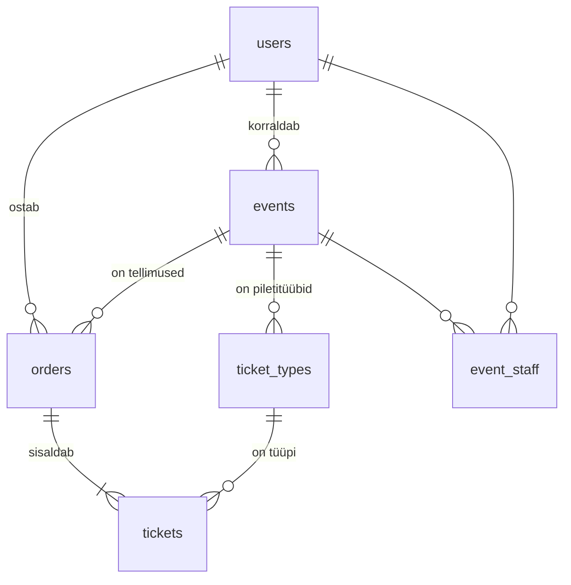

# 5. Andmebaas ja seosed

::: info Õpiväljund
Pärast seda lehte oskad selgitada, mis on tabel, rida, primaarvõti ja võõrvõti, tunned ära üks-mitmele ja mitu-mitmele seose ning oskad öelda, miks andmebaas mõnikord rea kustutamist keelab.
:::

## Olukord

Ostja ostab kaks piletit. Selle info peab rakendus kuhugi alles panema nii, et:

- homme saaks näha, **kes** mida ostis ja **millisele** üritusele;
- piletit ei saaks müüa rohkem, kui saalis on kohti;
- kui korraldaja muudab hiljem hinda, jääks juba ostetud pileti hind samaks;
- keegi ei saaks kogemata kustutada üritust, mille piletid on juba müüdud.

Kõik see on **andmebaasi** töö. Server võib taaskäivituda, aga andmebaas jätab meelde.

## Võrdlus: kaartidega kartoteek

Vanas raamatukogus oli kartoteek: igal raamatul oma kaart, igal lugejal oma kaart, ja laenutuse kaardil oli kirjas **raamatu number** ja **lugeja number**. Raamatu nime ei kirjutatud laenutuskaardile uuesti, sest number viitas raamatu kaardile.

| Kartoteegis | Andmebaasis |
| --- | --- |
| Kast ühte liiki kaartidega (raamatud) | **Tabel** (`events`) |
| Üks kaart | **Rida** (üks üritus) |
| Lahtrid kaardil (pealkiri, autor) | **Veerud** (`title`, `status`) |
| Kaardi number, mis on ainult sellel kaardil | **Primaarvõti** (`id`) |
| Laenutuskaardil olev raamatu number | **Võõrvõti** (`event_id`) |

**Kus võrdlus ei kehti:** kartoteegis võis laenutuskaardile kirjutada olematu raamatu numbri ja keegi ei märganud. Andmebaas **ei luba** viidata reale, mida pole olemas.

## Meie rakenduse tabelid



Joonist loetakse nii: **üks** kasutaja võib korraldada **mitu** üritust, **ühel** üritusel võib olla **mitu** piletitüüpi, **üks** tellimus sisaldab **ühte või mitut** piletit.

## Seosed

| Seos | Näide | Kuidas tehtud |
| --- | --- | --- |
| **Üks-mitmele** | Üks üritus, mitu piletitüüpi | "Mitme" poolel on võõrvõti: `ticket_types.event_id` |
| **Mitu-mitmele** | Üks turvamees mitmel üritusel, ühel üritusel mitu turvameest | Vahetabel `event_staff`, kus iga rida on üks paar (üritus, turvamees) |

Miks ei saa mitu-mitmele seost teha ühe veeruga? Kui üritusel oleks veerg `security_id`, mahuks sinna ainult üks turvamees. Kui turvamehel oleks veerg `event_id`, saaks ta olla ainult ühel üritusel. Vahetabel lahendab mõlemad.

## Andmebaas kontrollib ise

Kood võib sisaldada vigu. Seepärast paneme olulised reeglid ka **andmebaasi** endasse: siis ei pääse vigased andmed sisse isegi siis, kui koodis on viga.

| Reegel | Mida tähendab | Meie näide |
| --- | --- | --- |
| **Primaarvõti** | Iga rida on ühekordne | Sama turvameest ei saa samale üritusele teist korda lisada |
| **Võõrvõti** | Viidatav rida peab olemas olema | Piletit ei saa luua olematule tellimusele |
| **`restrict`** | Ei luba kustutada rida, millele viidatakse | Üritust, millel on tellimusi, ei saa kustutada |
| **`cascade`** | Kustutab viitavad read kaasa | Mustandi kustutamisel kaovad ka selle piletitüübid |
| **`check`** | Väärtus peab vastama tingimusele | `sold` ei tohi olla suurem kui `capacity` |
| **`not null`** | Väli peab olema täidetud | Üritusel peab olema pealkiri |

Millal `cascade`, millal `restrict`? Küsi: **kas viitavatel ridadel on ilma selleta mõtet?** Piletitüübil ilma ürituseta pole, seega `cascade`. Tellimus on aga raamatupidamise andmed, mida ei tohi kaotada, seega `restrict`.

## Katseta: tee tegevusi ja vaata tabeleid

<SchemaExplorer />

Märka:

- Üks ost muudab **kolme** tabelit korraga.
- Pileti juures on ka **hind** (`price_cents`), kuigi see on piletitüübis juba olemas. See on teadlik: pilet jätab meelde hinna **ostu hetkel**.
- Kustutamine võib õnnestuda (`cascade`) või olla keelatud (`restrict`). Mõlemal juhul otsustab andmebaas, mitte kood.

## Raha ja kuupäevad

Kaks asja, mis lähevad algajatel tihti valesti:

- **Raha on täisarv sentides.** `2500` tähendab 25,00 €. Komaga arvud on arvutis ebatäpsed: `0.1 + 0.2` annab `0.30000000000000004`. Rahaga ei tohi sellist viga tekkida.
- **Ajad on koos ajavööndiga.** Kontsert algab kell 19 Eesti ajal. Kui server on mõnes teises ajavööndis, peab aeg ikka õige olema.

## Mis juhtuks ilma?

| Ilma | Tagajärg |
| --- | --- |
| Võõrvõtmeta | Piletid, mis viitavad kustutatud tellimusele. Keegi ei tea, kellele need kuuluvad |
| `restrict`-ita | Kustutatud üritus võtab kaasa kõigi ostjate tellimused |
| `check`-ita | Koodiviga müüb 101 piletit 100-kohalisse saali |
| Vahetabelita | Üritusel saab olla ainult üks turvamees |

## Kuidas see meie koodis välja näeb

::: details Tabel koodis (võib vahele jätta)
Tabelid kirjeldatakse koodis. Sellest tehakse andmebaasi tabel (vt järgmine leht):

```ts
export const ticketTypeSchema = pgTable("ticket_types", {
    id: uuid().defaultRandom().primaryKey(),                    // primaarvõti
    eventId: uuid()
        .references(() => eventSchema.id, {onDelete: "cascade"}) // võõrvõti + cascade
        .notNull(),
    name: varchar({length: 100}).notNull(),
    priceCents: integer().notNull(),                           // raha sentides
    capacity: integer().notNull(),
    sold: integer().notNull().default(0),
}, (table) => [
    check("ticket_types_sold_check", sql`${table.sold} >= 0 AND ${table.sold} <= ${table.capacity}`),
]);
```

Mitu-mitmele vahetabel, kus primaarvõti on kahe veeru paar:

```ts
export const eventStaffSchema = pgTable("event_staff", {
    eventId: uuid().references(() => eventSchema.id, {onDelete: "cascade"}).notNull(),
    userId: uuid().references(() => user.id, {onDelete: "cascade"}).notNull(),
}, (table) => [primaryKey({columns: [table.eventId, table.userId]})]);
```
:::

## Kontrollküsimused

1. Mis vahe on primaarvõtmel ja võõrvõtmel?
2. Miks on turvamehed eraldi tabelis, mitte üritusel veeruna?
3. Korraldaja proovib kustutada üritust, millele on müüdud pileteid. Mis juhtub ja miks?
4. Miks on pileti hind kirjas ka pileti real, kuigi piletitüübil on hind olemas?

::: details Vastused
1. Primaarvõti eristab rida teistest samas tabelis. Võõrvõti on veerg, mis viitab teise tabeli primaarvõtmele.
2. See on mitu-mitmele seos: üks veerg mahutaks ainult ühe turvamehe. Vahetabelis on iga rida üks paar.
3. Andmebaas keelab (`restrict`), sest tellimused viitavad üritusele. Avaldatud üritus tühistatakse, mitte ei kustutata.
4. Pilet jätab meelde hinna ostu hetkel. Kui korraldaja hiljem hinda muudab, ei tohi juba ostetud pileti hind muutuda.
:::
