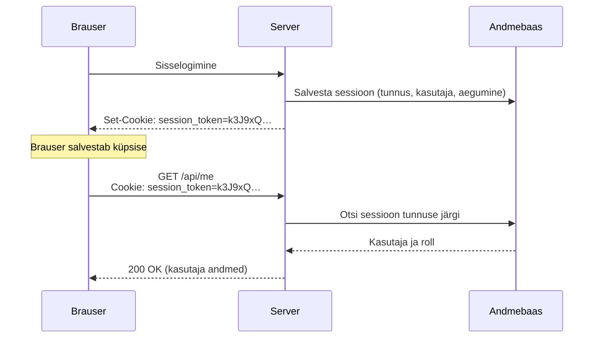

# 9. Küpsised, sessioonid ja tokenid

::: info Õpiväljund
Pärast seda lehte oskad selgitada, kuidas küpsis tekib ja miks brauser selle ise kaasa saadab, lugeda `Set-Cookie` ja `Cookie` päiseid, nimetada küpsise turvaatribuute ning võrrelda sessiooni ja JWT-d.
:::

## Olukord

[Esimesel lehel](./01-paringu-ja-vastuse-tsukkel) nägid, et server **ei mäleta** eelmist päringut. Iga päring on tema jaoks esimene. Aga korraldaja ei taha iga klõpsu peale uuesti sisse logida.

Lahendus: pärast sisselogimist saab brauser **tõendi**, mida ta saadab igal päringul kaasa. Server ei mäleta kasutajat, vaid kontrollib tõendit iga kord uuesti.

## Võrdlus: garderoobinumber

Teatris annad mantli garderoobi ja saad numbriga sildi. Silt ise ei ütle midagi sinu ega su mantli kohta, see on lihtsalt number. Garderoobitöötaja otsib numbri järgi riiulist õige mantli.

| Garderoobis | Rakenduses |
| --- | --- |
| Numbriga silt | **Küpsis** sessiooni tunnusega |
| Riiul mantlitega | **Sessioonid andmebaasis** |
| Näitad silti, saad mantli | Brauser saadab küpsise, server leiab kasutaja |
| Kaotatud silt: garderoob tühistab numbri | **Väljalogimine**: sessioon kustutatakse |

**Kus võrdlus ei kehti:** garderoobitöötaja näeb sind ja võib kahtlase inimese kinni pidada. Server näeb ainult silti. Kes silti näitab, see saab mantli. Seepärast on oluline, et silt ei lekiks.

## Kuidas küpsis tekib

Pärast edukat sisselogimist lisab server vastusesse `Set-Cookie` päise:

```http
HTTP/1.1 200 OK
Set-Cookie: session_token=k3J9xQ…; HttpOnly; Secure; SameSite=Lax; Max-Age=604800
```

Brauser salvestab küpsise ja saadab selle edaspidi **ise** kaasa iga sama saidi päringuga. Frontend'i kood ei pea selleks midagi tegema:

```http
GET /api/me HTTP/1.1
Host: api.example.com
Cookie: session_token=k3J9xQ…
```



## Küpsise atribuudid

| Atribuut | Mida teeb | Mille eest kaitseb |
| --- | --- | --- |
| `HttpOnly` | JavaScript ei näe küpsist (`document.cookie` seda ei näita) | Kui lehele satub pahatahtlik skript (XSS), ei saa see küpsist varastada |
| `Secure` | Küpsis liigub ainult HTTPS-i kaudu | Pealtkuulamine avalikus WiFis |
| `SameSite=Lax` | Teise saidi päringutega küpsist kaasa ei saadeta (välja arvatud tavaline lingile klõpsamine) | Teine sait ei saa sinu nimel andmeid muuta (CSRF, vt [API turvalisus](./11-api-turvalisus)) |
| `Max-Age` / `Expires` | Kui kaua küpsis kehtib | Unustatud seade ei jää igaveseks sisse logituks |

**Seansiküpsis** (ilma `Max-Age`-ita) kaob, kui brauser suletakse. **Püsiküpsis** jääb alles, kuni aeg täis saab, ka siis, kui brauser vahepeal suletakse. Meie rakenduse sessioon kehtib 7 päeva.

Kui sessiooni tunnus lekib, saab ründaja end kasutajana esitleda ilma parooli teadmata (*session hijacking*). Seepärast ei ole `HttpOnly` ja `Secure` valikulised lisad, vaid kohustuslikud.

## Sessioon või token?

Tõendit saab teha kahel viisil.

| | Sessioon andmebaasis | JWT (*JSON Web Token*) |
| --- | --- | --- |
| Mis on brauseris | Juhuslik tunnus | Andmed ise (kasutaja, roll, aegumine) + allkiri |
| Kuidas server kontrollib | Otsib tunnuse andmebaasist | Kontrollib allkirja, andmebaasi pole vaja |
| Väljalogimine | Kustutab sessiooni: kehtib kohe | Ei saa tühistada: kehtib, kuni aegub |
| Rolli muutus | Kehtib järgmisest päringust | Jõuab kohale alles uue tokeniga |
| Plussid | Täielik kontroll | Ei vaja andmebaasi, sobib mitme teenuse vahel |

Meie rakendus kasutab **sessiooni andmebaasis**. Väike lisapäring igal korral on odav hind selle eest, et väljalogimine ja rolli muutus kehtivad kohe.

## Katseta: sessioon vs JWT

<SessionSimulator />

JWT-l on oma koht: suured süsteemid, kus mitu teenust peavad kasutajat kontrollima ilma ühise andmebaasita. Siis tehakse token **lühiajaliseks** (nt 15 minutit) ja kasutatakse eraldi uuendamise tokenit. Nii jääb ohuaken väikeseks.

## Seos CORS-iga

Kui frontend ja API on eri aadressidel (nt `localhost:5173` ja `localhost:3000`), ei saada brauser küpsist vaikimisi kaasa. Vaja on kahte asja:

- frontend: `fetch(url, { credentials: "include" })` (axios: `withCredentials: true`);
- server: `Access-Control-Allow-Credentials: true` ja **konkreetne** lubatud aadress, mitte `*`.

Täpsemalt [API turvalisuse lehel](./11-api-turvalisus).

## Mis juhtuks ilma?

| Ilma | Tagajärg |
| --- | --- |
| Tõendita | Kasutaja peab iga klõpsu peale uuesti sisse logima |
| `HttpOnly`-ta | Üks XSS-viga lekitab kõigi kasutajate sessioonid |
| `Secure`-ta | Kohviku WiFis saab sessiooni pealt kuulata |
| Aegumiseta | Raamatukogu arvutisse unustatud sisselogimine kehtib igavesti |

## Kuidas see meie koodis välja näeb

::: details Sessiooni kontroll (võib vahele jätta)
Sessiooni loob ja küpsise paneb Better Auth. Meie kood ainult küsib igal päringul, kelle sessioon see on:

```ts
export const requireAuth: RequestHandler = async (req, res, next) => {
    // loeb küpsisest tunnuse ja otsib sessiooni andmebaasist
    const session = await auth.api.getSession({headers: fromNodeHeaders(req.headers)});
    if (!session) {
        res.status(401).json({error: "Pole sisse logitud"});
        return;
    }
    req.user = session.user; // koos värske rolliga
    next();
};
```
:::

## Proovi ise

Ava mõni sisselogimisega leht ja arendaja tööriistades **Application** (Chrome) või **Storage** (Firefox) paneel.

1. Leia **Cookies** alt sisselogimisel tekkinud küpsis.
2. Kontrolli, kas sellel on `HttpOnly` ja `Secure`.
3. Ava **Network** paneelist sisselogimise vastus ja leia `Set-Cookie` päis.
4. Ava mõni järgmine päring ja leia sealt `Cookie` päis.

## Kontrollküsimused

1. Miks peab brauser saatma küpsise igal päringul?
2. Mida teeb `HttpOnly` ja mille eest see kaitseb?
3. Kasutaja logib välja, aga ründajal on tema tõendi koopia. Mis vahe on sessioonil ja JWT-l?
4. Miks kasutab meie rakendus sessiooni, mitte JWT-d?

::: details Vastused
1. Server ei mäleta eelmist päringut. Ainult tõend ütleb talle, kes päringu tegi.
2. JavaScript ei näe küpsist. Kui lehele satub pahatahtlik skript, ei saa see sessiooni varastada.
3. Sessioon kustutatakse andmebaasist ja koopia muutub väärtusetuks (`401`). JWT kehtib kuni aegumiseni, sest serveris pole midagi, mida kustutada.
4. Väljalogimine ja rolli muutus peavad kehtima kohe. Lisapäring andmebaasi on selle eest väike hind.
:::

## Allikad

- [MDN: Using HTTP cookies](https://developer.mozilla.org/en-US/docs/Web/HTTP/Cookies)
- [OWASP: Session Management Cheat Sheet](https://cheatsheetseries.owasp.org/cheatsheets/Session_Management_Cheat_Sheet.html)
