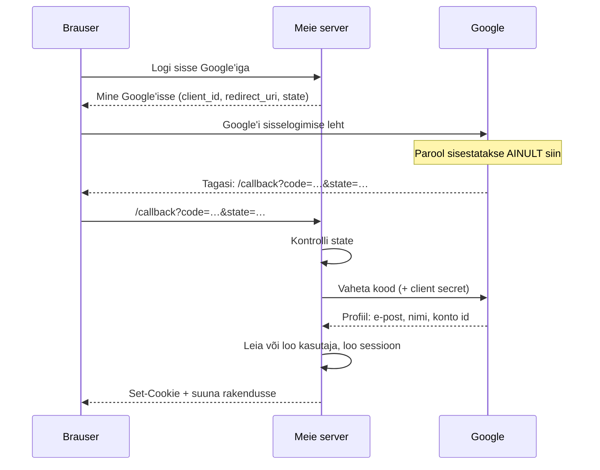

# 10. OAuth: logi sisse Google'iga

::: info Õpiväljund
Pärast seda lehte oskad kirjeldada, mis toimub „Logi sisse Google'iga” nupu taga, selgitada ühekordse koodi, `state` väärtuse ja *client secret*'i rolli ning põhjendada, miks rakendus ei hoia ise paroole.
:::

## Olukord

Meie rakenduses ei ole paroolivälja. Kasutaja vajutab „Logi sisse Google'iga” (või GitHubiga), käib korraks Google'i lehel ja on siis sisse logitud.

Miks nii? Paroolide hoidmine on raske ja ohtlik:

- paroolid tuleb salvestada nii, et isegi andmebaasi lekke korral neid kätte ei saaks;
- vaja on parooli taastamist, e-kirju, kaheastmelist kinnitust, kaitset arvamise vastu;
- inimesed kasutavad sama parooli mitmes kohas: kui meie leke paljastab parooli, on ohus ka nende e-post.

Google teeb seda kõike juba hästi. Meie rakendus küsib Google'ilt ainult üht asja: **kes see kasutaja on?**

## Võrdlus: hotelli võtmekaart passi asemel

Lähed hotelli, aga sul pole passi kaasas. Hotell helistab sinu kodulinna passilauda. Passilaud kontrollib sind ja ütleb hotellile: „Jah, see inimene on see, kes ta ütleb, ja tema e-post on …”. Hotell ei näe kunagi sinu passi ega PIN-koodi, aga teab nüüd, kes sa oled, ja annab oma võtmekaardi.

| Võrdluses | OAuthis |
| --- | --- |
| Passilaud | **Google** (*identity provider*) |
| Hotell | **Meie rakendus** |
| Passilaua kinnitus | Profiil: e-post, nimi, konto id |
| Hotelli võtmekaart | **Meie sessioon** ja küpsis (vt [eelmine leht](./09-sessioonid-ja-tokenid)) |

**Kus võrdlus ei kehti:** päris OAuthis ei helista hotell ise. Kasutaja **brauser** käib Google'i juures ja toob kaasa ühekordse koodi. Alles siis küsib meie server Google'ilt otse, mida see kood tähendab.

## Voog samm-sammult



| Osa | Mis see on | Miks vaja |
| --- | --- | --- |
| **client_id** | Meie rakenduse avalik nimi Google'i jaoks | Google teab, kes küsib, ja näitab kasutajale rakenduse nime |
| **redirect_uri** | Aadress, kuhu Google kasutaja tagasi saadab | Peab olema Google'is eelnevalt registreeritud, muidu saaks ründaja koodi enda juurde suunata |
| **code** | Ühekordne, lühiajaline kood | Läbib brauserit, seega ei tohi see üksi midagi anda |
| **client secret** | Meie rakenduse salajane võti | Ainult serveril. Ilma selleta ei saa koodi profiili vastu vahetada |
| **state** | Juhuslik väärtus, mille server alguses meelde jätab | Kontrollib, et tagasitulek kuulub sellele brauserile, kes sisselogimist alustas |

## Katseta: neli olukorda

<OAuthSimulator />

Võltsitud tagasisuunamise puhul tahab ründaja logida **ohvri** sisse **ründaja** kontoga. Siis näeks ründaja hiljem kõike, mida ohver seal tegi (nt sisestatud andmeid). `state` kontroll peatab selle, sest ohvri brauser ei alustanud sisselogimist.

## Konto ja kasutaja

Andmebaasis on kaks tabelit:

| Tabel | Mis seal on | Näide |
| --- | --- | --- |
| `user` | Meie rakenduse kasutaja: nimi, e-post, **roll** | Korraldaja |
| `account` | Kuidas see kasutaja sisse logib: teenus + selle teenuse konto id | `google` + `1093…` |

Ühel kasutajal võib olla mitu kontot (Google ja GitHub). Roll ja piletid on seotud **kasutajaga**, mitte kontoga. Seepärast ei kao midagi, kui kasutaja logib kord Google'i, kord GitHubiga.

## Mis juhtuks ilma?

| Ilma | Tagajärg |
| --- | --- |
| OAuthita (oma paroolid) | Paroolide hoidmine, taastamine ja leke on meie vastutus |
| `state` kontrollita | Ründaja saab ohvri oma kontoga sisse logida |
| Registreeritud `redirect_uri`-ta | Ründaja saab koodi oma serverisse suunata |
| *client secret*'i lekkimisel | Igaüks saab end meie rakendusena esitleda. Saladus hoitakse keskkonnamuutujas, mitte koodis ega Gitis |

## Kuidas see meie koodis välja näeb

::: details Seadistus (võib vahele jätta)
Kogu voo teeb Better Auth. Meie anname ainult rakenduse andmed (keskkonnamuutujatest):

```ts
export const auth = betterAuth({
    socialProviders: {
        google: {
            clientId: env.GOOGLE_CLIENT_ID,
            clientSecret: env.GOOGLE_CLIENT_SECRET, // ainult serveris, mitte Gitis
        },
        github: {
            clientId: env.GITHUB_CLIENT_ID,
            clientSecret: env.GITHUB_CLIENT_SECRET,
        },
    },
});
```

Tagasisuunamise aadress on `{BETTER_AUTH_URL}/api/auth/callback/google`. See peab Google Cloud Console'is olema kirjas täpselt samamoodi.
:::

**Teistes keeltes:** Spring Security OAuth2 Client, Laravel Socialite, Passport.js. Kõik teevad sama voogu.

## Kontrollküsimused

1. Miks ei näe meie server kunagi kasutaja Google'i parooli?
2. Kood läbib kasutaja brauserit. Miks ei ole see ohtlik?
3. Mille vastu kaitseb `state`?
4. Kasutaja on sidunud oma kontoga nii Google'i kui GitHubi. Mitu rida on tal `user` ja `account` tabelis?

::: details Vastused
1. Parool sisestatakse Google'i lehel. Meie server saab ainult ühekordse koodi ja vahetab selle profiili vastu.
2. Kood on ühekordne ja lühiajaline ning selle vahetamiseks on vaja *client secret*'i, mis on ainult meie serveris.
3. Selle vastu, et ründaja saadab ohvri brauseri meie tagasisuunamise aadressile oma koodiga ja logib ohvri sisse ründaja kontoga.
4. Üks rida `user` tabelis (roll ja piletid on siin) ja kaks rida `account` tabelis (google ja github).
:::
