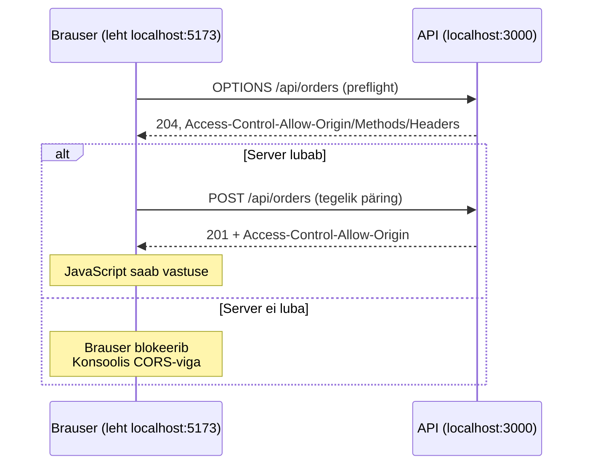

# 11. API turvalisus

::: info Õpiväljund
Pärast seda lehte oskad selgitada päritolu ja CORS-i, eristada brauseri turvareeglit serveri kaitsest, kirjeldada CSRF-rünnakut ja selle kaitset ning põhjendada päringute piirangu vajadust.
:::

## Olukord

Kasutaja on meie piletirakenduses sisse logitud. Samal ajal on tal teises brauseri vahelehes lahti mõni **teine leht**. See leht võib olla pahatahtlik. Küsimused:

- Kas teine leht saab lugeda kasutaja tellimusi meie API-st?
- Kas teine leht saab kasutaja nimel pileti osta?
- Mis siis, kui keegi kirjutab skripti, mis saadab meie API-le sekundis tuhat päringut?

Turvalisus koosneb **kihtidest**. Mõned kaitsed on brauseris, mõned serveris. Ükski kiht üksi ei piisa.

## Võrdlus: kontorihoone

Kontorihoones on mitu kaitsekihti: välisuksel uksekaart, vastuvõtus külaliste nimekiri, turvamees, kes ei lase ühtki inimest sada korda minutis sisse-välja käia, ja iga kontori uks eraldi lukus. Kui üks kiht ebaõnnestub, peatab järgmine.

| Kontorihoones | API-s |
| --- | --- |
| Uksekaart töötab ainult selles hoones | Küpsis `SameSite=Lax`: teise saidi päringuga ei lähe kaasa |
| Vastuvõtt kontrollib, kust külaline tuleb | Origin kontroll: andmeid muutvad päringud ainult meie aadressilt |
| Turvamees piirab sisse-välja käimist | Päringute piirang (`429`) |
| Kontori uks eraldi lukus | Sisselogimine, roll, omanik (vt [lehte 8](./08-autentimine-ja-autoriseerimine)) |

**Kus võrdlus ei kehti:** CORS-il pole kontorihoones head vastet. See ei ole uks ega lukk, vaid brauseri reegel, mis otsustab, kas leht tohib vastust **lugeda**. Sellest allpool.

## Päritolu (origin)

**Päritolu** koosneb kolmest osast: skeem, host ja port.

```text
http://localhost:5173    ← frontend
http://localhost:3000    ← API
```

Port erineb, seega on päritolud erinevad. Samuti erineb `https://localhost:5173` (teine skeem) ja `http://127.0.0.1:5173` (teine host).

**Same-origin reegel:** brauser ei lase ühe päritolu JavaScriptil vabalt lugeda teise päritolu vastuseid. Muidu saaks iga avatud leht lugeda sinu e-posti, pangakontot ja kõike muud, kuhu oled sisse logitud.

## CORS: server lubab, brauser jõustab

Meie frontend (`localhost:5173`) peab saama lugeda API (`localhost:3000`) vastuseid. **CORS** (*Cross-Origin Resource Sharing*) on päiste süsteem, millega server ütleb brauserile, millised teised päritolud tohivad vastust lugeda:

```http
Access-Control-Allow-Origin: http://localhost:5173
Access-Control-Allow-Credentials: true
```

Kui päring muudab andmeid või kasutab erilisi päiseid, saadab brauser enne `OPTIONS` päringu (*preflight*) ja küsib luba:



::: warning CORS ei kaitse serverit
CORS on **brauseri** reegel, mis kaitseb **kasutajat**. Skript, `curl` või teine server ei ole brauser ja ei järgi seda. Server peab alati ise kontrollima sisselogimist, õigusi ja sisendit.

Ära kasuta `Access-Control-Allow-Origin: *` koos küpsistega. Siis saaks iga leht kasutaja nimel päringuid teha.
:::

## CSRF: päring kasutaja nimel

**CSRF** (*Cross-Site Request Forgery*): kasutaja on meie rakenduses sisse logitud ja avab kurja lehe. See leht saadab meie API-le `POST /api/orders`. Vanasti pani brauser kasutaja küpsise kaasa ja server arvas, et kasutaja ise ostab.

Meie rakenduses on selle vastu **kaks kihti**:

1. **`SameSite=Lax` küpsis.** Teise saidi `POST` või `fetch` päringuga ei saada brauser küpsist üldse kaasa.
2. **Origin kontroll.** Andmeid muutev päring (`POST`, `PUT`, `PATCH`, `DELETE`) võõralt aadressilt saab `403`. Brauser lisab `Origin` päise ise ja lehe JavaScript ei saa seda võltsida.

## Päringute piirang

Ilma piiranguta saab üks skript saata tuhandeid päringuid: proovida arvata, koormata serverit või broneerida kõik piletid. Meie rakenduses:

- **100 päringut minutis IP kohta** kogu API-le;
- **10 ostukatset minutis kasutaja kohta**. Kasutaja, mitte IP, sest ühe kooli võrgu taga on palju inimesi sama IP-ga.

Piiri ületamisel vastab server `429 Too Many Requests` ja vastuse päisest saab lugeda, millal loendur nullitakse.

## Katseta: kolm päritolu, kolm päringut

<SecuritySimulator />

Märka:

- **Võõras leht** ei saa lugeda (CORS) ega osta (SameSite + Origin kontroll), kuigi see töötab kasutaja enda brauseris.
- **Skript** saab kõiki vastuseid lugeda (CORS ei puuduta teda), aga tal pole kasutaja küpsist. Seepärast saab ta ainult `401`.
- **Päringute piirang** kehtib kõigile, ka meie oma lehele.

## Veel kihte

| Kaitse | Mida teeb |
| --- | --- |
| **Turvapäised** (`helmet`) | Keelab brauseril võõraid skripte käivitada, peidab serveri tarkvara nime jne |
| **Keha suurus** (10 kB) | Hiiglaslik päring ei koorma serverit (`413`) |
| **Lehekülgedeks jagamine** | Nimekiri ei tagasta korraga 100 000 rida (`?limit=20&offset=0`, max 100) |
| **Üks ootel tellimus** | Bot ei saa kõiki pileteid broneerida ja jätta maksmata |
| **`npm audit`** | Leiab sõltuvustest teadaolevad haavatavused |

## OWASP API Top 10

[OWASP](https://owasp.org/API-Security/editions/2023/en/0x11-t10/) koostab nimekirja kõige levinumatest API turvavigadest. Meie lehed katavad suurema osa:

| OWASP | Oht | Kus käsitletud |
| --- | --- | --- |
| API1: objekti õigused | Võõra pileti nägemine | [Leht 8](./08-autentimine-ja-autoriseerimine) (omanik) |
| API2: autentimine | Sessiooni vargus või võltsimine | [Leht 9](./09-sessioonid-ja-tokenid) |
| API3: välja õigused | Klient muudab `role` või `status` välja | [Leht 3](./03-dto) (DTO) |
| API4: ressursid | Päringute tulv, suur keha, kõik read | See leht |
| API5: funktsiooni õigused | Ostja kasutab halduse aadressi | [Leht 8](./08-autentimine-ja-autoriseerimine) (roll) |
| API6: äriprotsess | Bot broneerib kõik piletid | See leht, [leht 7](./07-tehingud-ja-konkurents) |
| API8: konfiguratsioon | CORS `*`, puuduvad päised, CSRF | See leht |

## Mis juhtuks ilma?

| Ilma | Tagajärg |
| --- | --- |
| CORS-i lubatud nimekirjata (`*`) | Iga leht saab kasutaja nimel API-t kasutada |
| `SameSite` ja Origin kontrollita | Kuri leht ostab kasutaja nimel |
| Päringute piiranguta | Üks skript halvab serveri või broneerib kõik piletid |
| Keha piiranguta | Üks 1 GB päring täidab serveri mälu |

## Kuidas see meie koodis välja näeb

::: details Turvakihid järjekorras (võib vahele jätta)
```ts
app.use(helmet());                                           // turvapäised
app.use(cors({origin: allowedOrigins, credentials: true}));  // CORS lubatute nimekirjaga
app.use("/api", apiLimiter, originCheck);                    // 429 ja 403
app.use(express.json({limit: "10kb"}));                      // 413
```

Origin kontroll:

```ts
const SAFE_METHODS = ["GET", "HEAD", "OPTIONS"];

export const originCheck: RequestHandler = (req, res, next) => {
    const origin = req.header("origin");
    if (SAFE_METHODS.includes(req.method) || !origin || allowedOrigins.includes(origin)) {
        next();
        return;
    }
    res.status(403).json({error: "Päring teiselt aadressilt ei ole lubatud"});
};
```
:::

## CORS-vea uurimine

Kui konsoolis on CORS-viga:

1. kontrolli frontend'i ja API päritolu (skeem, host, port);
2. vaata Network-paneelist, kas toimus `OPTIONS` päring;
3. kontrolli vastuse `Access-Control-Allow-*` päiseid;
4. kontrolli, kas server ise vastas veaga (nt `500`): siis on CORS-viga ainult sümptom;
5. paranda serveri CORS-seadistust. Frontend'i koodiga CORS-i parandada ei saa.

Ära kasuta avalikku „CORS-proksit” päris rakenduses.

## Kontrollküsimused

1. Millised paarid on sama päritolu: `http://localhost:5173` ja `http://localhost:3000`, `http://localhost:5173` ja `https://localhost:5173`?
2. Miks ei kaitse CORS serverit?
3. Kuidas peatab meie rakendus CSRF-rünnaku?
4. Miks on ostukatsete piirang kasutaja, mitte IP kohta?

::: details Vastused
1. Kumbki paar ei ole sama päritolu: esimeses erineb port, teises skeem.
2. CORS on brauseri reegel. Skript või teine server ei järgi seda ja loeb kõik vastused. Server peab ise kontrollima sisselogimist ja õigusi.
3. Küpsis on `SameSite=Lax` (võõra saidi päringuga ei lähe kaasa) ja andmeid muutvad päringud võõralt Origin'ilt saavad `403`.
4. Ühe kooli või kontori võrgu taga on palju inimesi sama IP-ga. IP-põhine piirang karistaks kõiki neid ühe inimese pärast.
:::

## Allikad

- [MDN: CORS](https://developer.mozilla.org/en-US/docs/Web/HTTP/Guides/CORS)
- [MDN: Same-origin policy](https://developer.mozilla.org/en-US/docs/Web/Security/Same-origin_policy)
- [OWASP API Security Top 10 (2023)](https://owasp.org/API-Security/editions/2023/en/0x11-t10/)
