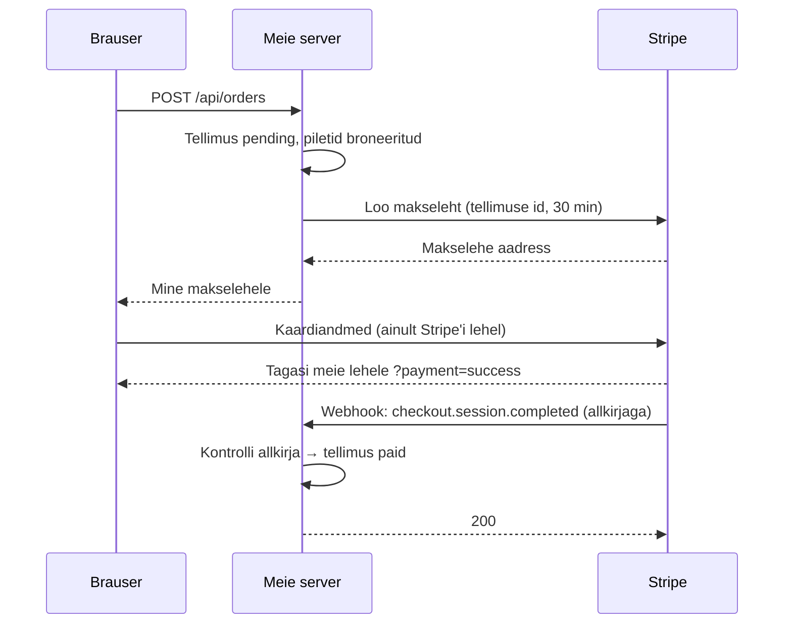

# 12. Välised teenused: maksed ja webhook

::: info Õpiväljund
Pärast seda lehte oskad selgitada, miks makse kinnitus tuleb webhookiga, mitte brauserist, kirjeldada webhooki allkirja eesmärki ja põhjendada, miks webhooki töötlemine peab olema korduskindel.
:::

## Olukord

Piletirakendus ei tegele ise kaardimaksetega. Kaardiandmete hoidmiseks on vaja ranget sertifitseerimist, pettuste tuvastamist ja pangalepinguid. Selle teeb **makseteenus** (meie rakenduses Stripe).

Aga see tekitab küsimuse: raha liigub Stripe'i lehel, mitte meie serveris. **Kust meie server teab, et tellimus on makstud?**

## Võrdlus: pakiautomaat

Tellid e-poest asja ja maksad. Pood ei looda sellele, et ütled „ma maksin”. Pood ootab **pangalt kinnitust**. Kui pakk jõuab pakiautomaati, saad SMS-i automaadi omanikult, mitte poelt ega kullerilt suusõnaliselt.

| Võrdluses | Rakenduses |
| --- | --- |
| Pood | Meie server |
| Pank, mis kinnitab makse | Stripe |
| „Ma maksin juba!” | Brauseri tagasisuunamine `?payment=success` |
| Panga kinnitus poele | **Webhook**: Stripe'i teavitus otse meie serverile |
| Panga pitsat kinnitusel | **Allkiri**: tõestab, et teavitus tuli päriselt Stripe'ilt |

**Kus võrdlus ei kehti:** pank saadab kinnituse ühe korra. Stripe võib sama teavitust saata **mitu korda** ja meie server peab sellega hakkama saama.

## Kuidas makse käib



Kaks asja juhtuvad **eraldi**:

1. **Brauser** suunatakse tagasi meie lehele. See on ainult mugavus kasutajale („aitäh ostu eest”). Seda aadressi saab igaüks käsitsi avada, seega see **ei tõenda midagi**.
2. **Stripe** saadab meie serverile otse teavituse (*webhook*). Ainult see muudab tellimuse makstuks.

## Webhook ja allkiri

**Webhook** on vastupidine tavalisele päringule: mitte meie ei küsi Stripe'ilt „kas makstud?”, vaid Stripe teatab meile ise, kui midagi juhtub. Selleks on meil avalik aadress `POST /api/payments/webhook`.

Kuna aadress on avalik, võib igaüks sinna päringu saata. Seepärast **allkirjastab** Stripe iga teavituse saladusega, mida teavad ainult Stripe ja meie server. Server arvutab allkirja ise üle: kui see ei klapi, vastab `400` ega muuda midagi.

::: tip Miks töötlemata keha
Allkiri arvutatakse täpselt nendest baitidest, mille Stripe saatis. Kui server jõuaks keha enne JSON-objektiks teha, muutuksid tühikud ja järjekord ning allkiri ei klapiks. Seepärast on webhooki route [middleware'i ahelas](./04-middleware-ja-veatootlus) **enne** JSON-i lugemist.
:::

## Korduskindlus

Stripe saadab sama teavitust uuesti, kui meie server ei vastanud `2xx`-iga (näiteks vastus jäi teel kaduma). Vahel saadab ta seda ka niisama. Seega peab sama teavituse teistkordne töötlemine olema **ohutu**:

- „märgi makstuks” muudab ainult tellimust, mis on veel `pending`. Teine kord pole midagi muuta;
- vastus on ikka `200`, mitte viga. Viga paneks Stripe'i sama teavitust aina uuesti saatma.

Seda omadust nimetatakse **korduskindluseks** (*idempotency*): sama tegevus kaks korda annab sama tulemuse mis üks kord.

## Katseta: viis olukorda

<PaymentSimulator />

## Gateway: üks koht välise teenuse jaoks

Stripe'iga räägib meie koodis ainult **üks klass** (`PaymentGateway`). See on sama mõte mis repository andmebaasi puhul (vt [kihtide lehte](./02-kihiline-arhitektuur)):

| Repository | Gateway |
| --- | --- |
| Teab, kuidas andmebaasiga rääkida | Teab, kuidas Stripe'iga rääkida |
| Äriloogikat ei tea | Äriloogikat ei tea |
| Andmebaasi vahetus → muutub ainult repository | Makseteenuse vahetus → muutub ainult gateway |
| Testis saab asendada testandmebaasiga | Testis saab asendada võltsinguga (ei tee päris makseid) |

## Mis tehingusse ei kuulu

Makselehe loomine on **pärast** broneeringu tehingut, mitte selle sees (vt [tehingute lehte](./07-tehingud-ja-konkurents)). Väline teenus võib vastata sekundeid ja kogu selle aja oleksid piletitüüpide read lukus. Kui makselehe loomine ebaõnnestub, vabastab server broneeringu ise.

## Mis juhtuks ilma?

| Ilma | Tagajärg |
| --- | --- |
| Webhookita (usaldame brauserit) | Igaüks avab `?payment=success` ja saab pileti tasuta |
| Allkirjata | Igaüks saadab „makstud” teavituse ja saab pileti tasuta |
| Korduskindluseta | Korduv teavitus tekitab vea või muudab andmeid teist korda |
| Aegumiseta | Maksmata tellimused hoiavad pileteid igavesti kinni |
| Gateway'ta | Stripe'i kutsed on laiali üle koodi ja teenuse vahetus on suur töö |

## Kuidas see meie koodis välja näeb

::: details Webhooki töötlemine (võib vahele jätta)
```ts
async handleWebhook(rawBody: Buffer, signature: string | undefined): Promise<void> {
    const event = this.paymentGateway.parseWebhookEvent(rawBody, signature); // kontrollib allkirja
    if (!event) {
        throw new BadRequestError("Vigane Stripe'i allkiri"); // 400
    }
    switch (event.type) {
        case "checkout.session.completed":
            await this.orderService.markPaid(event.data.object.client_reference_id, ...);
            break;
        case "checkout.session.expired":
            await this.orderService.expire(event.data.object.client_reference_id);
            break;
        // muud sündmused: vastame ikka 200, muidu saadab Stripe neid uuesti
    }
}
```

`markPaid` on korduskindel, sest muudab ainult ootel tellimust:

```sql
UPDATE orders SET status = 'paid' WHERE id = ? AND status = 'pending' RETURNING *;
-- teisel korral: 0 rida → ei tee midagi
```
:::

## Kontrollküsimused

1. Miks ei märgi server tellimust makstuks, kui brauser jõuab aadressile `?payment=success`?
2. Webhooki aadress on avalik. Miks ei saa igaüks sinna „makstud” teavitust saata?
3. Stripe saadab sama teavituse kaks korda. Mis juhtub ja miks?
4. Mis on gateway ja miks see on eraldi klass?

::: details Vastused
1. Seda aadressi saab igaüks käsitsi avada. Makset tõendab ainult Stripe'i allkirjastatud webhook.
2. Iga teavitus on allkirjastatud saladusega, mida teavad ainult Stripe ja meie server. Võltsingul pole õiget allkirja (`400`).
3. Teisel korral pole tellimus enam `pending` ja midagi ei muutu. Vastus on ikka `200`, et Stripe ei saadaks uuesti.
4. Ainus koht, mis välise teenusega räägib. Teenuse vahetamisel või testimisel muutub või asendatakse ainult see.
:::
