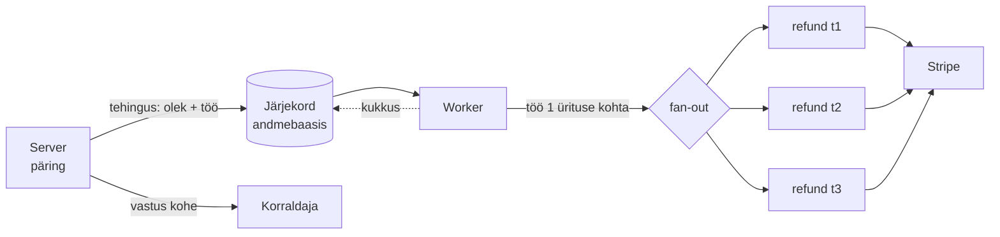

# 13. Taustatööd ja järjekorrad

::: info Õpiväljund
Pärast seda lehte oskad selgitada, millal tasub töö panna järjekorda, kirjeldada workeri ja uuesti proovimise rolli ning põhjendada, miks korduv töö peab olema korduskindel.
:::

## Olukord

Korraldaja tühistab kontserdi, millele on müüdud 300 piletit. Kõik 300 ostjat peavad saama raha tagasi. Iga tagasimakse on päring makseteenusele ja võtab umbes sekundi.

Kui server teeks kõik tagasimaksed **päringu ajal**:

- korraldaja vaataks 5 minutit laadivat lehte ja brauser katkestaks ootamise;
- kui server vahepeal taaskäivitub (uus versioon, viga), jääb osa tagasimakseid tegemata ja keegi ei tea, millised;
- kui makseteenus on hetkeks maas, kukub kogu tühistamine läbi.

## Võrdlus: restorani tellimuslehed

Ettekandja ei seisa köögis, kuni toit valmib. Ta kirjutab tellimuse lehele, paneb selle köögi aknale järjekorda ja läheb tagasi saali. Kokk võtab lehti järjest. Kui üks roog ebaõnnestub, teeb kokk selle uuesti, aga leht jääb aknale, kuni roog on päriselt valmis.

| Restoranis | Rakenduses |
| --- | --- |
| Ettekandja võtab tellimuse ja läheb tagasi saali | Server paneb töö järjekorda ja vastab kohe |
| Tellimuslehed köögi aknal | **Järjekord** (andmebaasis) |
| Kokk | **Worker**: eraldi programm, mis võtab töid järjest |
| Roog ebaõnnestub, kokk teeb uuesti | **Uuesti proovimine** (*retry*) |
| Leht jääb aknale, kuni roog on valmis | Töö kaob järjekorrast alles siis, kui see õnnestus |

**Kus võrdlus ei kehti:** kokk mäletab, et ta juba tegi poole roast. Worker ei mäleta: kordusel alustab ta töö algusest ja peab ise kontrollima, mis on juba tehtud.

## Kuidas see töötab



1. **Server** muudab ürituse oleku ja paneb töö järjekorda **samas tehingus**. Kui üks ei õnnestu, ei jää alles kumbki.
2. Server vastab kohe. Korraldaja ei oota.
3. **Worker** (eraldi protsess, `npm run worker`) võtab töö ja leiab kõik kehtivad piletid.
4. **Fan-out**: iga pileti kohta tuleb eraldi töö. Ühe pileti viga ei sega teisi.
5. Iga pileti töö: tagasimakse Stripe'is, siis pilet `cancelled` ja `sold − 1`.
6. Kui töö kukub, proovib järjekord uuesti: 10 s, 20 s, 40 s... kuni 5 korda.

## Miks järjekord andmebaasis?

Lihtsaim „taustatöö” oleks käivitada funktsioon ilma ootamata. Aga siis on töö ainult **mälus**: serveri taaskäivitusel kaob see jäljetult. Järjekord andmebaasis (meil `pg-boss` PostgreSQL-is):

- **ei kao** taaskäivitusel;
- saab panna **samasse tehingusse** muude muudatustega;
- teab, mitu korda tööd on proovitud, ja proovib uuesti;
- laseb serveri ja workeri **eraldi** käivitada ja vajadusel mitu workerit lisada.

## Korduskindlus ja idempotency key

Uuesti proovimine on hea, aga ohtlik. Kujuta ette: worker tegi tagasimakse ära ja kukkus just enne, kui jõudis andmebaasi märkida „pilet tühistatud”. Järjekord näeb, et töö pole lõpetatud, ja annab selle uuesti. Worker näeb andmebaasis „pilet on kehtiv” ja maksab **uuesti** tagasi.

Kaks kaitset:

1. **Worker kontrollib alguses seisu.** Kui pilet pole enam kehtiv, on töö juba tehtud: lõpeta vaikselt (mitte viga, muidu proovitaks aina uuesti).
2. **Idempotency key.** Tagasimakse päringuga saadetakse võti `refund-<pileti id>`. Kui sama võtmega päring tuleb teist korda, ei tee Stripe uut tagasimakset, vaid tagastab esimese tulemuse.

## Katseta: viis olukorda

<JobSimulator />

## Millal järjekorda kasutada?

| Järjekorda | Päringu sisse |
| --- | --- |
| Aeglane töö (sekundid, minutid) | Kiire töö (millisekundid) |
| Väline teenus, mis võib maas olla | Ainult oma andmebaas |
| Palju sarnaseid töid (300 tagasimakset) | Üks muudatus |
| Kasutaja ei vaja tulemust kohe | Kasutaja vajab vastust kohe |

Näiteks pileti **skännimine** uksel ei käi järjekorra kaudu: turvamees vajab vastust kohe („sisse” või „ei”).

## Mis juhtuks ilma?

| Ilma | Tagajärg |
| --- | --- |
| Järjekorrata | Pikk ootamine, katkenud päringud, poolikud tagasimaksed |
| Mälus olev järjekord | Taaskäivitusel kaovad tööd |
| Töö väljaspool tehingut | Üritus jääb avaldatuks, aga tagasimaksed lähevad käima (või vastupidi) |
| Uuesti proovimiseta | Makseteenuse lühike häire jätab ostjad rahata |
| Korduskindluseta | Kordus maksab raha topelt tagasi |

## Kuidas see meie koodis välja näeb

::: details Töö järjekorda ja worker (võib vahele jätta)
Töö pannakse järjekorda samas tehingus ürituse olekuga:

```ts
await this.db.transaction(async (tx) => {
    await this.updateStatus(id, "cancelled", tx);
    await this.jobQueue.eventCancelled(id, tx); // ROLLBACK viib ka töö ära
});
```

Worker on korduskindel:

```ts
async refund(ticketId: string): Promise<void> {
    const ticket = await this.ticketRepository.findById(ticketId);
    if (!ticket || ticket.status !== "active") {
        return; // juba tehtud: mitte viga
    }
    // sama võti sama pileti kohta → Stripe maksab tagasi ainult üks kord
    await this.paymentGateway.refund(ticket.stripePaymentIntentId, ticket.priceCents, `refund-${ticket.id}`);
    await this.db.transaction(async (tx) => { /* pilet cancelled, sold - 1 */ });
}
```

Kordamise seadistus: `retryLimit: 5`, `retryDelay: 10`, `retryBackoff: true`.
:::

**Teistes keeltes:** Java: Spring Batch, Quartz, JobRunr. PHP: Laravel Queues. Node.js: BullMQ (Redis), pg-boss (PostgreSQL).

## Kontrollküsimused

1. Miks ei tehta 300 tagasimakset päringu ajal?
2. Miks pannakse töö järjekorda samas tehingus ürituse oleku muutmisega?
3. Worker tegi tagasimakse ja kukkus enne andmebaasi muutmist. Mis hoiab ära teise tagasimakse?
4. Miks lõpetab worker vaikselt, kui pilet pole enam kehtiv, selle asemel et visata viga?

::: details Vastused
1. See võtaks minuteid, katkeks ja taaskäivitusel jääks osa tegemata. Järjekorras on töö andmebaasis ja seda proovitakse uuesti.
2. Et ei tekiks olukorda, kus üritus on tühistatud, aga tagasimakseid pole (või vastupidi). Kas mõlemad või kumbki.
3. Idempotency key: Stripe tunneb sama võtme ära ja ei tee uut tagasimakset.
4. Viga paneks järjekorra tööd uuesti proovima, kuigi töö on juba tehtud.
:::
