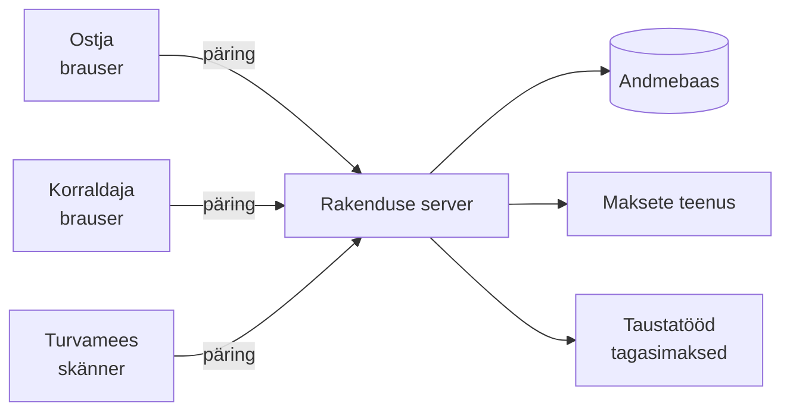

# Veebirakendused

::: info Õpiväljund
Selgitad oma sõnadega, kuidas veebirakendus töötab: mis juhtub, kui klõpsad nupul, kuhu andmed salvestuvad, kes kontrollib, et sa tohid seda teha, ja miks rakendus on ehitatud just nii.
:::

Iga veebirakenduse taga on sama küsimus: **mis juhtub vahepeal?** Sa vajutad "Osta pilet" ja paari sekundi pärast on pilet sinu e-postis. Aga mis toimus nende sekundite jooksul?

Selles moodulis vaatame seda sisse piletimüügi rakenduse näitel. Kasutame tehnoloogiat (Node.js, PostgreSQL jt) ainult näidetena. **Mõisted on samad, olenemata sellest, kas rakendus on tehtud JavaScriptis, Javas või PHP-s.** Kui oled need mõisted ära õppinud, tunned ära sama mustri ka võõras projektis.

Moodul on kirjutatud nii, et seda saab lugeda ka siis, kui sa pole kunagi koodi kirjutanud. Iga leht algab tavalise elu näitega. Kood tuleb alles pärast seda ja on lahtivolditavates plokkides.

## Läbiv näide: piletimüügi rakendus

Kõik lehed kasutavad sama näidet: **kontserdipiletite müügi rakendust**. Selle ülesanded on:

- **korraldaja** saab **luua ürituse** (nt sügiskontsert), määrata aja, koha ja hinna ning ürituse avaldada;
- **ostjad** näevad avaldatud üritusi ja saavad **pileti osta**;
- osta saab ainult nii palju pileteid, kui saalis kohti on, ka siis, kui sada inimest vajutab **korraga** "Osta";
- makse käib läbi pangateenuse, mis rakendusest eraldi töötab;
- uksel **skännib turvamees** pileti QR-koodi ja süsteem ütleb, kas pilet kehtib;
- kui kontsert jääb ära, saavad kõik raha tagasi.

See on päris rakenduse kirjeldus. Sama näide kulgeb läbi kõigi moodulis olevate lehtede. Iga leht võtab ühe osa ja seletab, miks see rakenduses on, mis juhtuks ilma ja kuidas see tavaliselt tehtakse.

## Kaks poolt: backend ja frontend

Veebirakendus koosneb tavaliselt kahest osast.

| Pool | Kus töötab | Mida teeb | Restorani näites |
| --- | --- | --- | --- |
| **Frontend** | Kasutaja brauseris | Näitab nuppe ja tekste, võtab vastu klõpsud | Menüü ja söögisaal |
| **Backend** | Serveris | Hoiab andmeid, kontrollib reegleid, teeb töö | Köök ja ladu |

Frontend ei tohi kunagi usaldada ainult iseennast: brauseris olev kood on kasutaja käes ja kasutaja võib seda muuta. Seepärast on **reeglid ja andmed backend'is**. Selle teema kohta tuleb lehti nii backend'i kui frontend'i osas.

::: tip Praegu valmis
See mooduli osa kirjeldab **backend'i**. Frontend (kuidas brauseris olev osa töötab) lisandub hiljem.
:::

## Läbiv võrdlus: restoran

Paljud mõisted on kergemini mõistetavad, kui võrrelda neid restoraniga. Kasutame seda võrdlust läbi kogu mooduli, aga **iga kord ütleme ka, kus võrdlus enam ei kehti**, sest iga võrdlus eksib kuskil.

| Restoranis | Rakenduses |
| --- | --- |
| Külaline tellib menüüst | Klient (brauser) saadab päringu |
| Uks ja turvamees | Vahepealne kontroll (*middleware*) |
| Ettekandja | *Controller*: võtab tellimuse vastu ja toob roa |
| Kokk | *Service*: reeglid, mida tuleb järgida |
| Laohoidja | *Repository*: oskab ladu kasutada |
| Ladu | Andmebaas |
| Tellimuse ankeet | *DTO*: kindel kuju, mida võib saata |

## Backend'i teekond

1. [Päringu ja vastuse tsükkel](./backend/01-paringu-ja-vastuse-tsukkel): mis juhtub, kui ostja avab ürituste lehe?
2. [Kihid: kes mida teeb?](./backend/02-kihiline-arhitektuur): miks kood on jagatud route'ideks, controller'iteks, service'iteks ja repository'deks?
3. [DTO: mis tohib sisse ja välja minna?](./backend/03-dto): miks ei tohi klient ise endale ürituse omanikku määrata?
4. [Middleware ja veatöötlus](./backend/04-middleware-ja-veatootlus): miks on kontrollide järjekord tähtis ja kuidas veast saab korralik vastus?
5. [Andmebaas ja seosed](./backend/05-andmebaas-ja-seosed): tabelid, võtmed ja miks andmebaas mõnikord ütleb „ei”.
6. [ORM ja migratsioonid](./backend/06-orm-ja-migratsioonid): kuidas kood andmebaasiga räägib ja kuidas muudatus jõuab igasse andmebaasi?
7. [Tehingud ja konkurents](./backend/07-tehingud-ja-konkurents): kuidas viimane pilet läheb täpselt ühele ostjale?
8. [Autentimine ja autoriseerimine](./backend/08-autentimine-ja-autoriseerimine): kes sa oled ja mida sa tohid?
9. [Küpsised, sessioonid ja tokenid](./backend/09-sessioonid-ja-tokenid): kuidas server mäletab, et oled sisse loginud?
10. [OAuth: logi sisse Google'iga](./backend/10-oauth): miks meie server ei näe kunagi sinu parooli?
11. [API turvalisus](./backend/11-api-turvalisus): CORS, CSRF ja päringute piirang.
12. [Välised teenused: maksed ja webhook](./backend/12-valised-teenused): kust server teab, et makse tuli?
13. [Taustatööd ja järjekorrad](./backend/13-taustatood-ja-jarjekorrad): kuidas 300 tagasimakset tehakse ilma ootamata ja topelt maksmata?
14. [Konfiguratsioon ja saladused](./backend/14-konfiguratsioon): kuidas sama kood jookseb eri keskkondades ja paroolid ei satu Giti?

::: details Tulevad lehed
- Logimine ja jälgitavus
- API leping (OpenAPI)
- Testimine backend'is
- Sõnastik
:::

## Kuidas lehti lugeda

Iga leht on ehitatud ühtemoodi:

1. **Olukord**: konkreetne juhtum piletimüügi rakendusest.
2. **Võrdlus**: mõiste igapäevase näitega ja märge, kus võrdlus ei kehti.
3. **Mis juhtuks ilma?** Probleem, mida mõiste lahendab.
4. **Kuidas see välja näeb**: skeem ja lühike koodinäide (lahtivolditav plokk, vahele jätta võib).
5. **Kontrollküsimused** vastustega.
